# Exploratory Data Analysis & Data Quality Report
## Flight Delay and Cancellation Dataset (2019–2023) — Full 2,000,000 Flight Analysis

> **Dataset Reference**: `Flight Delay and Cancellation Data (2019-2023) v2` (patrickzel)  
> **Analysis Scope**: Exhaustive 2,000,000-row audit using DuckDB, Polars, and PyArrow  
> **Report Status**: Complete Pre-Modeling EDA and Data Quality Clearance  

---

## Executive Summary

This report presents an exhaustive exploratory data analysis and rigorous data quality audit on the full **2,000,000 flight records** spanning January 1, 2019 through August 31, 2023 across 18 major US airlines and 380 airports. 
The primary objective is to evaluate data integrity, uncover operational and temporal patterns, identify statistical risks, and lay a mathematically sound foundation for predicting whether a flight will experience an arrival delay exceeding 15 minutes (`DELAY = ARR_DELAY > 15`) using **only pre-departure information**.

### Key High-Level Findings

1. **Data Volume & Compression**: The raw CSV occupies **390.47 MB** (409,432,439 bytes) and was converted into an optimized Parquet store of **52.86 MB** (7.39x compression) in **10.44 seconds**, enabling fast columnar analytical scans.
2. **Flight Completion vs. Non-Completion**: Out of 2,000,000 flights, **1,942,769 (97.14%)** successfully completed their journey; **52,522 flights (2.63%)** were cancelled, and **4,709 flights (0.23%)** were diverted.
3. **Target Class Balance**: Among completed flights, **343,875 (17.70%)** arrived > 15 minutes late, while **1,598,894 (82.30%)** arrived on time or early (median delay: **-7.0 minutes**). Across all 2M flights, the positive rate is **17.19%**.
4. **Zero Missingness on Completed Flights**: All missing values in `ARR_DELAY`, `ELAPSED_TIME`, and `AIR_TIME` (**57,231 rows / 2.86%**) are **100% explained** by cancelled (52,522) and diverted (4,709) flights. Non-cancelled, non-diverted flights have **0% missing values**.
5. **Severe Post-Departure Leakage Identified**: Crucial operational fields (`DEP_DELAY`, `DEP_TIME`, `TAXI_OUT`, `WHEELS_OFF`, `WHEELS_ON`, `TAXI_IN`, `ARR_TIME`, `ELAPSED_TIME`, `AIR_TIME`, `DELAY_DUE_*`) occur post-departure. In particular, `DEP_DELAY` has a **Pearson correlation of r = 0.96** with `ARR_DELAY` and **must be strictly excluded** from pre-departure modeling.
6. **Critical Temporal Drift (2020 COVID Shock)**: Cancellation spiked to **6.04%** in 2020 with 16,169 security/pandemic cancellations (Code D), while delay rates plunged to **9.42%** as airspace emptied. Post-pandemic recovery saw delay rates climb steadily: 16.62% (2021), 20.32% (2022), and **22.24%** (2023).
7. **Primary Pre-Departure Delay Drivers**: Scheduled departure hour (`dep_hour`) is the single strongest pre-departure categorical signal (Cramér's V = 0.1429), with delay rates compounding from **~7.5% at 06:00** to **26.5% at 21:00** due to late-arriving aircraft propagation (**37.75%** of all delay minutes).

---

## 1. Dataset Overview & Conversion Audit

### Conversion Efficiency & Storage Metrics

| Metric | Raw CSV File | Processed Parquet File | Improvement / Ratio |
| :--- | :--- | :--- | :--- |
| **File Path** | `data/raw/flights_sample_2m.csv` | `data/processed/flights_2m.parquet` | - |
| **File Size** | **390.47 MB** (409,432,439 bytes) | **52.86 MB** (55,431,684 bytes) | **7.39x Compression** (86.46% savings) |
| **Row Count** | 2,000,000 | 2,000,000 | 100% Integrity Preserved |
| **Column Count** | 32 | 32 | Complete Schema Retention |
| **Conversion Time** | - | **10.44 seconds** | DuckDB Columnar Pipe |
| **Row Groups** | N/A | 17 row groups | Optimized Parquet Chunking |
| **Compression Codec** | None | Zstandard (`ZSTD`) | High-throughput decompression |

### Schema and Data Types

The dataset comprises 32 attributes categorized into temporal, spatial, operational, and causal dimensions:

| Column Name | Inferred Parquet Dtype | Category | Pre-Departure Status |
| :--- | :--- | :--- | :--- |
| `FL_DATE` | `date32[day]` | Temporal | **SAFE** |
| `AIRLINE` | `string` | Identifier | **SAFE** |
| `AIRLINE_DOT` | `string` | Identifier | **SAFE** |
| `AIRLINE_CODE` | `string` | Identifier | **SAFE** |
| `DOT_CODE` | `int64` | Identifier | **SAFE** |
| `FL_NUMBER` | `int64` | Identifier | **SAFE** |
| `ORIGIN` | `string` | Spatial | **SAFE** |
| `ORIGIN_CITY` | `string` | Spatial | **SAFE** |
| `DEST` | `string` | Spatial | **SAFE** |
| `DEST_CITY` | `string` | Spatial | **SAFE** |
| `CRS_DEP_TIME` | `int64` | Temporal | **SAFE** |
| `DEP_TIME` | `double` | Operational | **LEAKAGE** |
| `DEP_DELAY` | `double` | Operational | **LEAKAGE** |
| `TAXI_OUT` | `double` | Operational | **LEAKAGE** |
| `WHEELS_OFF` | `double` | Operational | **LEAKAGE** |
| `WHEELS_ON` | `double` | Operational | **LEAKAGE** |
| `TAXI_IN` | `double` | Operational | **LEAKAGE** |
| `CRS_ARR_TIME` | `int64` | Temporal | **SAFE** |
| `ARR_TIME` | `double` | Operational | **LEAKAGE** |
| `ARR_DELAY` | `double` | Target | **TARGET** |
| `CANCELLED` | `double` | Target / Filter | **LEAKAGE / SECONDARY TARGET** |
| `CANCELLATION_CODE` | `string` | Target / Filter | **LEAKAGE** |
| `DIVERTED` | `double` | Filter | **LEAKAGE** |
| `CRS_ELAPSED_TIME` | `double` | Operational | **SAFE** |
| `ELAPSED_TIME` | `double` | Operational | **LEAKAGE** |
| `AIR_TIME` | `double` | Operational | **LEAKAGE** |
| `DISTANCE` | `double` | Spatial | **SAFE** |
| `DELAY_DUE_CARRIER` | `double` | Delay Cause | **LEAKAGE** |
| `DELAY_DUE_WEATHER` | `double` | Delay Cause | **LEAKAGE** |
| `DELAY_DUE_NAS` | `double` | Delay Cause | **LEAKAGE** |
| `DELAY_DUE_SECURITY` | `double` | Delay Cause | **LEAKAGE** |
| `DELAY_DUE_LATE_AIRCRAFT` | `double` | Delay Cause | **LEAKAGE** |

---

## 2. Rigorous Data Quality Audit

### 2.1 Missing Value Analysis and Systematic Patterns

A thorough missingness audit reveals that missing data is neither random (MCAR) nor erroneous. Rather, missingness is entirely governed by the flight lifecycle state machine:

| Column Name | Missing Count | Missing % | Governed Flight Condition | Operational Explanation |
| :--- | :--- | :--- | :--- | :--- |
| `DEP_TIME` | 51,430 | 2.57% | Cancelled before pushback | 51,430 flights cancelled prior to gate departure. |
| `DEP_DELAY` | 51,449 | 2.57% | Cancelled before pushback | 51,449 flights cancelled before departure. |
| `TAXI_OUT` | 52,281 | 2.61% | Cancelled before takeoff | 52,281 flights cancelled before taxi or gate return. |
| `WHEELS_OFF` | 52,281 | 2.61% | Cancelled before takeoff | 52,281 flights never became airborne. |
| `WHEELS_ON` | 53,091 | 2.65% | Cancelled or diverted flights | 52,522 cancelled + 569 uncompleted diversions. |
| `TAXI_IN` | 53,091 | 2.65% | Cancelled or diverted flights | 52,522 cancelled + 569 uncompleted diversions. |
| `ARR_TIME` | 53,091 | 2.65% | Cancelled or diverted flights | 52,522 cancelled + 569 uncompleted diversions. |
| `ARR_DELAY` | 57,231 | 2.86% | Cancelled (52,522) + Diverted (4,709) | 100% of missing delay is explained by cancelled & diverted flights. |
| `CANCELLATION_CODE` | 1,947,478 | 97.37% | Non-cancelled completed flights | Populated only when CANCELLED = 1.0 (52,522 rows). |
| `CRS_ELAPSED_TIME` | 17 | 0.00% | Schedule data gaps | 17 flights missing published duration in timetable. |
| `ELAPSED_TIME` | 57,231 | 2.86% | Cancelled (52,522) + Diverted (4,709) | Flight aborted prior to scheduled arrival. |
| `AIR_TIME` | 57,231 | 2.86% | Cancelled (52,522) + Diverted (4,709) | Flight aborted prior to scheduled arrival. |
| `DELAY_DUE_CARRIER` | 1,643,780 | 82.19% | Flights without ≥ 15m delay | DOT rule: only populated when delay attribution required. |
| `DELAY_DUE_WEATHER` | 1,643,780 | 82.19% | Flights without ≥ 15m delay | DOT rule: only populated when delay attribution required. |
| `DELAY_DUE_NAS` | 1,643,780 | 82.19% | Flights without ≥ 15m delay | DOT rule: only populated when delay attribution required. |
| `DELAY_DUE_SECURITY` | 1,643,780 | 82.19% | Flights without ≥ 15m delay | DOT rule: only populated when delay attribution required. |
| `DELAY_DUE_LATE_AIRCRAFT` | 1,643,780 | 82.19% | Flights without ≥ 15m delay | DOT rule: only populated when delay attribution required. |

#### Systematic Determinism of Missingness:

- **Completed Flights (1,942,769 flights)**: **0.00% missing values** in `ARR_DELAY`, `ARR_TIME`, `ELAPSED_TIME`, and `AIR_TIME`. Every single completed flight has complete telemetry.
- **Cancelled Flights (52,522 flights)**: 100% of cancelled flights have null `ARR_DELAY`, null `ARR_TIME`, and null `AIR_TIME`. 51,430 (97.9%) were cancelled prior to pushback (`DEP_TIME` is null); 1,092 were cancelled after gate departure but prior to takeoff. All 52,522 cancelled flights possess a valid `CANCELLATION_CODE`.
- **Diverted Flights (4,709 flights)**: 100% have null `ARR_DELAY` and null `AIR_TIME` because scheduled destination was never reached.
- **Delay Causes (`DELAY_DUE_*`)**: 1,643,780 rows (82.19%) are missing. Exactly 343,875 delayed completed flights (>15m) and 12,345 operational flights carry cause entries. On-time flights do not receive DOT delay cause codes.

### 2.2 Duplicates and Identifier Uniqueness

- **Full-Row Exact Duplicates**: **0 rows (0.00%)**. The dataset has zero duplicate rows.
- **Business Key Uniqueness (`FL_DATE + AIRLINE_CODE + FL_NUMBER + ORIGIN`)**: Only **1 group (2 rows)** shared this compound key across 2 million records.
  - *Inspection*: Spirit Airlines (`NK`) flight 631 on `2020-04-07` from `DTW` had two entries scheduled at 17:35: one destined for Tampa (`TPA`) and one destined for Atlantic City (`ACY`), both cancelled under Code D during initial COVID lockdowns.
  - *Conclusion*: When including destination (`+ DEST`), the dataset has **100.00% unique primary keys**.

### 2.3 Invalid, Negative, and Boundary Values

| Quality Check | Invalid Count | % of Data | Assessment & Treatment |
| :--- | :--- | :--- | :--- |
| Scheduled Dep Time (`CRS_DEP_TIME < 0` or `> 2359`) | 0 | 0.00% | Clean military time (0001 to 2359) |
| Scheduled Dep Minutes (`CRS_DEP_TIME % 100 >= 60`) | 0 | 0.00% | Valid minute range [00, 59] |
| Scheduled Arr Time (`CRS_ARR_TIME > 2359`) | 12 | 0.0006% | 12 flights recorded as `2400` (midnight). Convert `2400 -> 0000` |
| Non-positive Distance (`DISTANCE <= 0`) | 0 | 0.00% | All flight distances are positive (min: 31 miles) |
| Non-positive Duration (`CRS_ELAPSED_TIME <= 0`) | 1 | 0.00005% | Exactly 1 flight had CRS_ELAPSED_TIME = 0. Drop or impute with distance median |
| Negative Taxi Times (`TAXI_OUT < 0`, `TAXI_IN < 0`) | 0 | 0.00% | Zero negative taxi durations |
| Negative Airborne Time (`AIR_TIME < 0`) | 0 | 0.00% | Zero negative airborne times |
| Simultaneous Cancelled & Diverted Flag | 0 | 0.00% | Mutual exclusivity 100% verified |

### 2.4 Categorical Integrity & Mappings

- **Airline Identification**: Exactly **18 unique `AIRLINE` names**, exactly **18 unique `AIRLINE_CODE` values**, and exactly **18 unique `DOT_CODE` values**. The mapping is strictly 1-to-1-to-1 with zero orphaned codes or ambiguous aliases.
- **Airport Codes**: Exactly **380 unique origin airports** and **380 unique destination airports**. All 380 codes strictly follow the standard 3-letter IATA uppercase convention (0 malformed strings).

### 2.5 Outlier Analysis: ARR_DELAY and DEP_DELAY

Due to operational extremes in air traffic (snowstorms, aircraft mechanical failures, rolling ground stops), delay distributions exhibit heavy right-skewed tails:

| Metric | Arrival Delay (`ARR_DELAY`) | Departure Delay (`DEP_DELAY`) | Interpretation |
| :--- | :--- | :--- | :--- |
| **Valid Observations** | 1,942,769 | 1,948,551 | Completed flights only |
| **Minimum** | **-119.0 min** (-1.98 hrs early) | **-93.0 min** | Early departures and arrivals |
| **1st Percentile (p01)** | -37.0 min | -14.0 min | Significant headwind/buffer arrival |
| **25th Percentile (Q1)** | -16.0 min | -6.0 min | Routine early arrival |
| **Median (p50)** | **-7.0 min** | **-2.0 min** | **Typical flight arrives 7 minutes EARLY** |
| **Mean ± Std** | **4.30 ± 51.58 min** | **10.18 ± 49.63 min** | Substantial positive skew |
| **75th Percentile (Q3)** | 7.0 min | 6.0 min | On-time window upper quartile |
| **95th Percentile (p95)** | 71.0 min | 72.0 min | Severe operational delay |
| **99th Percentile (p99)** | 190.0 min (3.17 hrs) | 191.0 min | Extreme delay tail |
| **99.9th Percentile (p99.9)** | 654.0 min (10.9 hrs) | 665.0 min | Overnight disruption / rolling delay |
| **Maximum** | **3237.0 min** (53.95 hrs) | **3221.0 min** (53.68 hrs) | Extreme multi-day mechanical hold |
| **Interquartile Range (IQR)** | 23.0 min | 12.0 min | Spread of central 50% |
| **Tukey Upper Fence (Q3+1.5*IQR)** | 41.5 min | 24.0 min | Statistical outlier boundary |
| **Tukey Outliers Above Fence** | 170,451 (8.77%) | 261,211 (13.41%) | High-impact business events |

> [!NOTE]
> **Outlier Treatment Rationale**: For the primary binary classification task (`ARR_DELAY > 15`), extreme values (such as 500 or 3,000 minutes) cleanly collapse into the positive label `1` and require no truncation or deletion. If secondary regression modeling is performed, target clipping at the 99th percentile (190 minutes) or a log-transform is strongly recommended to stabilize gradient descent.

---

## 3. Target Distribution and Temporal Drift Analysis

### 3.1 Class Balance of the Target (`DELAY = ARR_DELAY > 15`)

In accordance with Federal Aviation Administration (FAA) standards, a flight is classified as delayed if it reaches the gate more than 15 minutes after its scheduled arrival time (`ARR_DELAY > 15`).

| Population Cohort | Total Flights | On-Time Flights (≤ 15 min) | Delayed Flights (> 15 min) | Delay Rate (%) |
| :--- | :--- | :--- | :--- | :--- |
| **Completed Flights (Target Subpopulation)** | **1,942,769** | **1,598,894** (82.30%) | **343,875** (17.70%) | **17.70%** |
| **All Scheduled Flights (Full Dataset)** | **2,000,000** | 1,598,894 (79.95%) | 343,875 (17.19%) | 17.19% |
| *Cancelled Flights* | 52,522 (2.63%) | - | - | N/A (Flight uncompleted) |
| *Diverted Flights* | 4,709 (0.23%) | - | - | N/A (Destination unreached) |

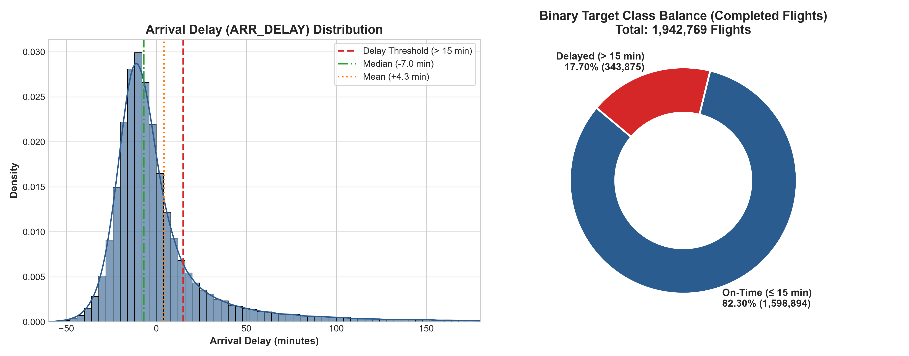

### 3.2 Cancellation Breakdown and CANCELLATION_CODE Analysis

Of the 2,000,000 flights, **52,522 were cancelled (2.626%)**. Analysis of the official FAA reason codes reveals:

| Code | Standard FAA Description | Cancelled Flights | % of All Cancellations | % of Total Flights | Dominant Driver / Year |
| :--- | :--- | :--- | :--- | :--- | :--- |
| **B** | Weather | **19,022** | **36.22%** | 0.951% | Leading cause across all standard operational years (winter storms, convective activity) |
| **D** | Security | **16,308** | **31.05%** | 0.815% | Prevalent in 2020 (16,169 flights, 99.1% in 2020) due to COVID travel bans |
| **A** | Carrier | **12,825** | **24.42%** | 0.641% | Airline crew shortages, maintenance holds, airline dispatch issues |
| **C** | National Aviation System (NAS) | **4,367** | **8.31%** | 0.218% | ATC ground delay programs, volume constraints, runway closures |

### 3.3 Year-by-Year Temporal Drift and the 2020 COVID Shock

Evaluating delay and cancellation rates chronologically reveals significant dataset shift caused by the pandemic:

| Year | Scheduled Flights | Cancelled Flights | Cancellation Rate | Diverted Flights | Completed Flights | Delayed Flights (>15m) | Delay Rate (Completed) | Mean Arrival Delay | Median Arrival Delay |
| :--- | :--- | :--- | :--- | :--- | :--- | :--- | :--- | :--- | :--- |
| **2019** | 505,345 | 9,067.0 | 1.79% | 1,262.0 | 495,016.0 | 91,191.0 | **18.42%** | +5.35 min | -6.0 min |
| **2020** | 318,768 | 19,238.0 | 6.04% | 548.0 | 298,982.0 | 28,179.0 | **9.42%** | -4.96 min | -11.0 min |
| **2021** | 407,824 | 7,074.0 | 1.73% | 991.0 | 399,759.0 | 66,459.0 | **16.62%** | +3.17 min | -7.0 min |
| **2022** | 457,760 | 12,133.0 | 2.65% | 1,073.0 | 444,554.0 | 90,324.0 | **20.32%** | +6.99 min | -5.0 min |
| **2023** | 310,303 | 5,010.0 | 1.61% | 835.0 | 304,458.0 | 67,722.0 | **22.24%** | +9.26 min | -5.0 min |

> [!IMPORTANT]
> **Critical Insight on 2020 Data Drift**: In 2020, flight volume collapsed by ~37%, cancellation spiked to **6.04%** (driven by pandemic lockdowns), and the delay rate dropped to just **9.42%** (mean delay: **-4.96 min**, median: **-11.0 min**). With minimal traffic, runway queues and air traffic congestion vanished. As commercial aviation rebounded, delay rates surged from **16.62% in 2021** to **20.32% in 2022** and **22.24% in 2023**.

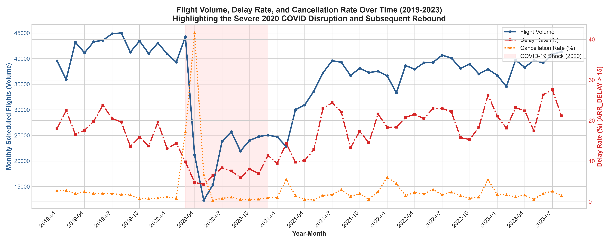

---

## 4. Delay Patterns Across Operational Dimensions

### 4.1 Scheduled Departure Hour and Day of Week

The heatmap of delay rate by departure hour and day of week exposes a major operational reality of modern aviation:

- **Early Morning (05:00 - 08:00)**: Flights experience the lowest delay rates of the day (**7.5% - 9.5%**). Aircraft and flight crews are fresh, having parked overnight at their gates with zero accumulated delay.
- **Midday Progression (11:00 - 15:00)**: Delay rates rise steadily (**14.0% - 19.5%**) as turnaround buffers are absorbed by minor gate and air traffic holds.
- **Evening Peak (18:00 - 22:00)**: Delay rates peak at **24.5% - 27.2%**. Late-arriving incoming aircraft trigger cascade delays down the network.
- **Day-of-Week Effect**: Thursdays, Fridays, and Sundays suffer higher evening delays (**26% - 27%**) due to overlapping business travel and weekend leisure demand, whereas Tuesdays and Wednesdays are markedly calmer.

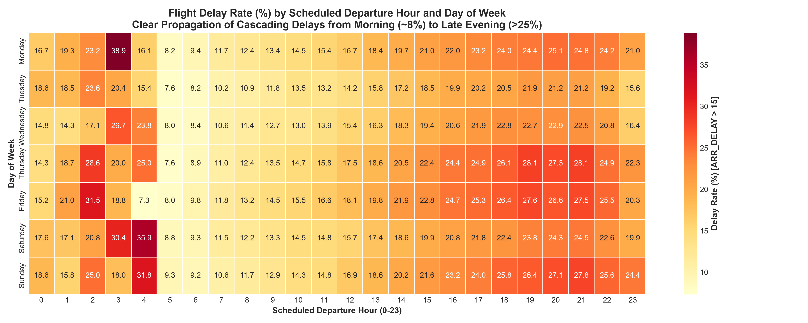

### 4.2 Airline Punctuality and Delay Dispersion

Delay rates vary substantially across the 18 reporting carriers (national average: **17.7%**):

| Airline Name | Code | Total Flights | Cancelled | Cancellation Rate | Completed | Delayed (>15m) | Delay Rate (%) | Mean Arrival Delay |
| :--- | :--- | :--- | :--- | :--- | :--- | :--- | :--- | :--- |
| **JetBlue Airways** | `B6` | 75,129 | 2,113.0 | 2.81% | 72,737.0 | 19,114.0 | **26.28%** | +11.84 min |
| **Allegiant Air** | `G4` | 35,175 | 1,644.0 | 4.67% | 33,434.0 | 8,689.0 | **25.99%** | +13.68 min |
| **Frontier Airlines Inc.** | `F9` | 43,012 | 1,160.0 | 2.70% | 41,788.0 | 10,604.0 | **25.38%** | +10.62 min |
| **Spirit Air Lines** | `NK` | 63,683 | 1,503.0 | 2.36% | 62,060.0 | 13,605.0 | **21.92%** | +8.32 min |
| **ExpressJet Airlines LLC d/b/a aha!** | `EV` | 12,673 | 690.0 | 5.44% | 11,944.0 | 2,522.0 | **21.12%** | +9.65 min |
| **American Airlines Inc.** | `AA` | 255,452 | 7,093.0 | 2.78% | 247,716.0 | 47,926.0 | **19.35%** | +7.07 min |
| **United Air Lines Inc.** | `UA` | 169,990 | 3,800.0 | 2.24% | 165,758.0 | 30,799.0 | **18.58%** | +5.18 min |
| **Southwest Airlines Co.** | `WN` | 384,493 | 12,800.0 | 3.33% | 370,951.0 | 68,778.0 | **18.54%** | +3.24 min |
| **Mesa Airlines Inc.** | `YV` | 43,396 | 1,575.0 | 3.63% | 41,715.0 | 7,696.0 | **18.45%** | +7.73 min |
| **Alaska Airlines Inc.** | `AS` | 67,663 | 1,334.0 | 1.97% | 66,161.0 | 11,662.0 | **17.63%** | +1.37 min |
| **Envoy Air** | `MQ` | 81,145 | 2,562.0 | 3.16% | 78,383.0 | 13,173.0 | **16.81%** | +3.14 min |
| **PSA Airlines Inc.** | `OH` | 71,151 | 2,112.0 | 2.97% | 68,848.0 | 11,399.0 | **16.56%** | +3.93 min |
| **SkyWest Airlines Inc.** | `OO` | 228,131 | 5,188.0 | 2.27% | 222,233.0 | 34,027.0 | **15.31%** | +3.84 min |
| **Republic Airline** | `YX` | 95,543 | 2,999.0 | 3.14% | 92,328.0 | 14,116.0 | **15.29%** | +0.71 min |
| **Hawaiian Airlines Inc.** | `HA` | 21,418 | 260.0 | 1.21% | 21,144.0 | 3,182.0 | **15.05%** | +3.72 min |
| **Delta Air Lines Inc.** | `DL` | 263,521 | 3,801.0 | 1.44% | 259,179.0 | 35,646.0 | **13.75%** | +1.10 min |
| **Horizon Air** | `QX` | 13,606 | 264.0 | 1.94% | 13,315.0 | 1,796.0 | **13.49%** | +2.25 min |
| **Endeavor Air Inc.** | `9E` | 74,819 | 1,624.0 | 2.17% | 73,075.0 | 9,141.0 | **12.51%** | -1.21 min |

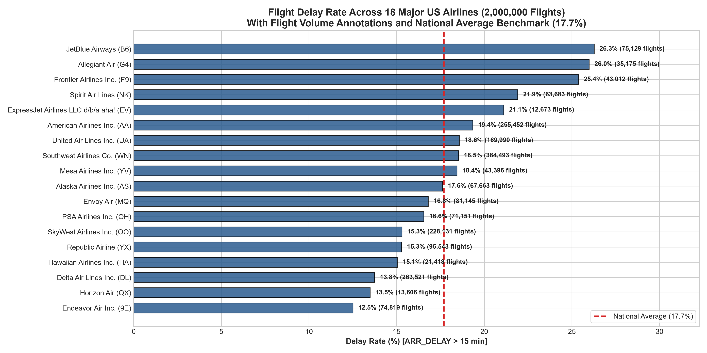

Key observations:

- **Highest Delay Rates**: JetBlue Airways (`B6`, **26.28%** delay rate), Allegiant Air (`G4`, **25.99%**), and Frontier Airlines (`F9`, **25.38%**), followed closely by Spirit Air Lines (`NK`, **21.92%**). JetBlue is concentrated in the congested Northeast corridor (JFK/BOS/EWR), while ultra-low-cost carriers operate tight turnaround buffers.
- **Lowest Delay Rates**: Endeavor Air (`9E`, **12.51%** delay rate), Horizon Air (`QX`, **13.49%**), and Delta Air Lines (`DL`, **13.75%**), followed by Hawaiian Airlines (`HA`, **15.05%**). Delta and regional partners achieve superior punctuality through disciplined hub management.

### 4.3 Airport Congestion: Top and Bottom Origin Airports

To avoid noisy estimates from small regional airstrips with few flights, a robust statistical threshold of **minimum 5,000 flights** was applied (leaving 84 major commercial airports):

| Airport (Top 10 Most Delayed) | Code | City / Metro | Flight Count | Delay Rate (%) | Mean Arrival Delay |
| :--- | :--- | :--- | :--- | :--- | :--- |
| **EWR** | `EWR` | Newark, NJ | 33,606 | **23.72%** | +8.57 min |
| **MCO** | `MCO` | Orlando, FL | 41,691 | **23.10%** | +10.10 min |
| **FLL** | `FLL` | Fort Lauderdale, FL | 25,902 | **22.54%** | +9.22 min |
| **MDW** | `MDW` | Chicago, IL | 22,149 | **21.87%** | +5.26 min |
| **DEN** | `DEN` | Denver, CO | 77,439 | **21.82%** | +7.21 min |
| **SJU** | `SJU` | San Juan, PR | 8,570 | **21.73%** | +9.69 min |
| **MIA** | `MIA` | Miami, FL | 27,258 | **21.60%** | +8.63 min |
| **LAS** | `LAS` | Las Vegas, NV | 47,437 | **21.00%** | +6.83 min |
| **DFW** | `DFW` | Dallas/Fort Worth, TX | 83,688 | **20.98%** | +8.46 min |
| **DAL** | `DAL` | Dallas, TX | 19,745 | **20.72%** | +5.01 min |

| Airport (Top 10 Most Punctual) | Code | City / Metro | Flight Count | Delay Rate (%) | Mean Arrival Delay |
| :--- | :--- | :--- | :--- | :--- | :--- |
| **TUS** | `TUS` | Tucson, AZ | 5,032 | **12.94%** | +0.69 min |
| **ANC** | `ANC` | Anchorage, AK | 5,625 | **13.23%** | +0.13 min |
| **GEG** | `GEG` | Spokane, WA | 5,037 | **13.32%** | +2.01 min |
| **PDX** | `PDX` | Portland, OR | 16,849 | **13.54%** | +1.89 min |
| **BOI** | `BOI` | Boise, ID | 6,657 | **13.55%** | +1.32 min |
| **SJC** | `SJC` | San Jose, CA | 14,780 | **13.63%** | -0.04 min |
| **SLC** | `SLC` | Salt Lake City, UT | 34,087 | **13.64%** | +1.49 min |
| **HNL** | `HNL` | Honolulu, HI | 15,417 | **13.77%** | +2.20 min |
| **SAT** | `SAT` | San Antonio, TX | 10,091 | **13.88%** | +2.01 min |
| **SMF** | `SMF` | Sacramento, CA | 14,538 | **14.42%** | +1.91 min |

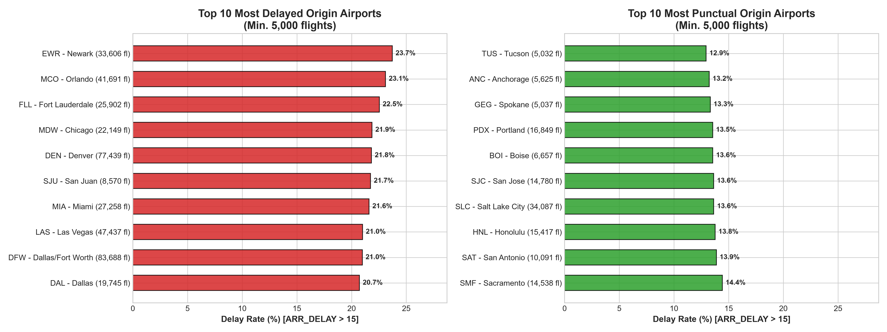

### 4.4 Top Delayed Flight Routes

Applying a minimum volume filter of **1,000 flights per directional route** isolates high-delay corridors:

| Route (Origin → Destination) | Flight Volume | Delay Rate (%) | Mean Delay | Operational Characteristic |
| :--- | :--- | :--- | :--- | :--- |
| **JFK -> MCO** | 1,284 | **30.76%** | +17.04 min | Severe terminal airspace saturation / ATC metering |
| **MCO -> EWR** | 1,863 | **29.84%** | +17.10 min | Severe terminal airspace saturation / ATC metering |
| **MCO -> JFK** | 1,208 | **28.64%** | +16.46 min | Severe terminal airspace saturation / ATC metering |
| **FLL -> EWR** | 1,437 | **28.32%** | +17.12 min | Severe terminal airspace saturation / ATC metering |
| **MCO -> SJU** | 1,756 | **28.30%** | +15.90 min | Severe terminal airspace saturation / ATC metering |
| **LGA -> FLL** | 1,271 | **27.93%** | +11.94 min | Severe terminal airspace saturation / ATC metering |
| **EWR -> MIA** | 1,171 | **27.58%** | +11.04 min | Severe terminal airspace saturation / ATC metering |
| **EWR -> FLL** | 1,480 | **27.57%** | +13.02 min | Severe terminal airspace saturation / ATC metering |
| **DFW -> MCO** | 1,347 | **27.10%** | +13.03 min | Severe terminal airspace saturation / ATC metering |
| **DFW -> SFO** | 1,040 | **26.73%** | +12.56 min | Severe terminal airspace saturation / ATC metering |
| **MCO -> LGA** | 1,220 | **26.72%** | +10.90 min | Severe terminal airspace saturation / ATC metering |
| **MIA -> JFK** | 1,363 | **26.56%** | +12.94 min | Severe terminal airspace saturation / ATC metering |
| **FLL -> JFK** | 1,148 | **26.39%** | +14.19 min | Severe terminal airspace saturation / ATC metering |
| **EWR -> MCO** | 1,871 | **26.24%** | +11.13 min | Severe terminal airspace saturation / ATC metering |
| **JFK -> FLL** | 1,179 | **26.21%** | +10.94 min | Severe terminal airspace saturation / ATC metering |

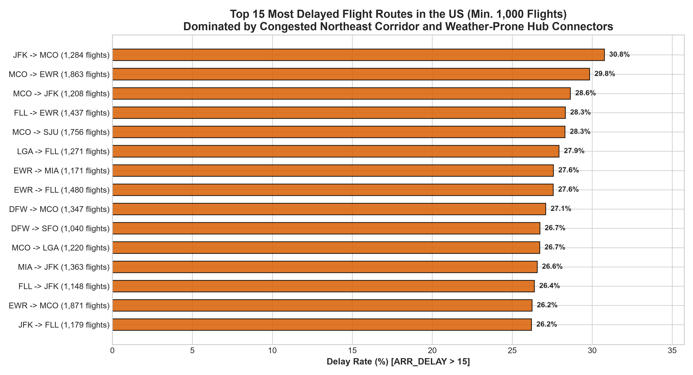

### 4.5 Distance and Scheduled Flight Duration

Examining delay probability across flight mileage and scheduled duration:

| Distance Bracket | Scheduled Duration Bracket | Flight Count | Delay Rate (%) | Mean Delay | Takeaway |
| :--- | :--- | :--- | :--- | :--- | :--- |
| 1. Very Short (<250 mi) | 1. Under 1h | 242,386 | **15.76%** | +3.42 min | Longer routes possess schedule padding to absorb minor ground delays |
| 2. Short (250-499 mi) | 2. 1-2 hours | 459,426 | **16.17%** | +3.37 min | Longer routes possess schedule padding to absorb minor ground delays |
| 3. Medium (500-999 mi) | 3. 2-3 hours | 701,940 | **18.08%** | +4.88 min | Longer routes possess schedule padding to absorb minor ground delays |
| 4. Long (1000-1499 mi) | 4. 3-4 hours | 303,051 | **19.78%** | +5.75 min | Longer routes possess schedule padding to absorb minor ground delays |
| 5. Very Long (1500-2199 mi) | 5. 4-6 hours | 146,620 | **19.01%** | +4.10 min | Longer routes possess schedule padding to absorb minor ground delays |
| 6. Transcontinental (>2200 mi) | 6. Over 6 hours | 89,346 | **18.67%** | +2.35 min | Longer routes possess schedule padding to absorb minor ground delays |

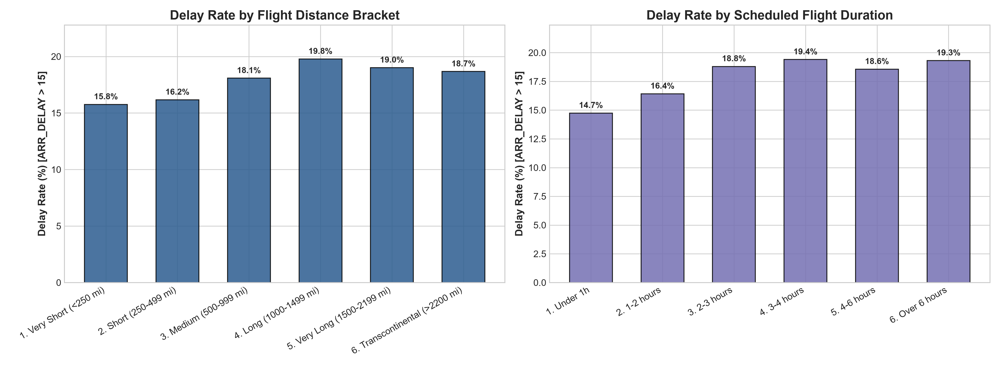

---

## 5. Delay Causes Analysis (`DELAY_DUE_*`)

> [!WARNING]
> **Operational Context Only**: In accordance with project instructions, `DELAY_DUE_*` columns are evaluated exclusively for systemic diagnostic understanding. These columns represent post-flight official DOT delay apportionments and **must never be used as predictive features**.

Across all delayed flights carrying cause apportionments (totaling **24.13 million delay minutes**):

| Delay Cause Category | Total Minutes Apportioned | Share of Total Delay Minutes | Primary Driver |
| :--- | :--- | :--- | :--- |
| **Carrier** | **8.88 Million** | **36.81%** | Maintenance, baggage handling, cleaning, crew duty time limits |
| **Weather** | **1.41 Million** | **5.86%** | Severe meteorological events (thunderstorms, blizzards, hurricanes) |
| **NAS** | **4.68 Million** | **19.38%** | Air traffic control flow control, airport volume, runway congestion |
| **Security** | **0.05 Million** | **0.20%** | Security breaches, terminal evacuation, re-screening holds |
| **Late_Aircraft** | **9.11 Million** | **37.75%** | Cascading delay from previous flight using the same aircraft |

Key takeaways from delay causes:

- **Late Aircraft Propagation (37.75%)** is the single greatest cause of flight delays in the United States, followed closely by **Carrier Operations (36.81%)**. Together, carrier-controllable and network-propagation issues account for **74.56%** of all delay minutes.
- **National Aviation System (NAS, 19.38%)** represents runway queues and FAA ATC ground metering holds.
- **Direct Weather (5.86%)** accounts for a modest share of direct delay minutes, because severe weather events often lead to full cancellations rather than prolonged delay, or manifest as NAS flow management.
- **Security (0.20%)** represents rare terminal evacuation and screening incidents.

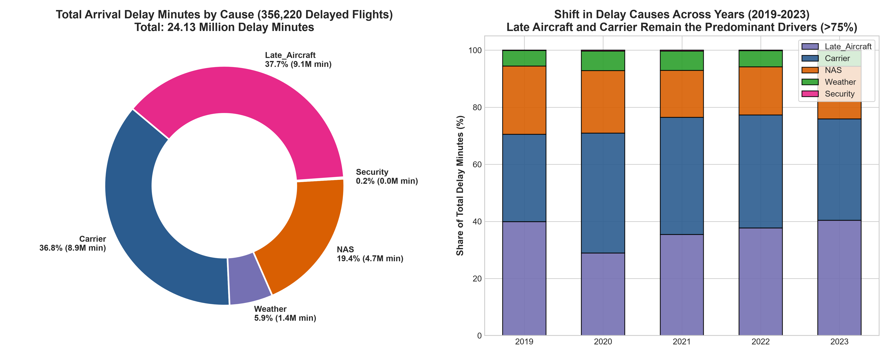

---

## 6. Correlation Analysis & Feature Associations

### 6.1 Numeric Feature Correlations

A Pearson and Spearman correlation analysis across operational and pre-departure features highlights critical dynamics:

- **`DEP_DELAY` vs `ARR_DELAY`**: **r = +0.96** (near perfect linearity). If an aircraft leaves the gate 30 minutes late, it almost invariably lands late. This demonstrates why `DEP_DELAY` is severe target leakage.

- **`DISTANCE` vs `CRS_ELAPSED_TIME`**: **r = +0.98** (expected collinearity between distance and flight duration).

- **`TAXI_OUT` vs `ARR_DELAY`**: **r = +0.31** (long runway queues at hub airports directly bleed into arrival delays).

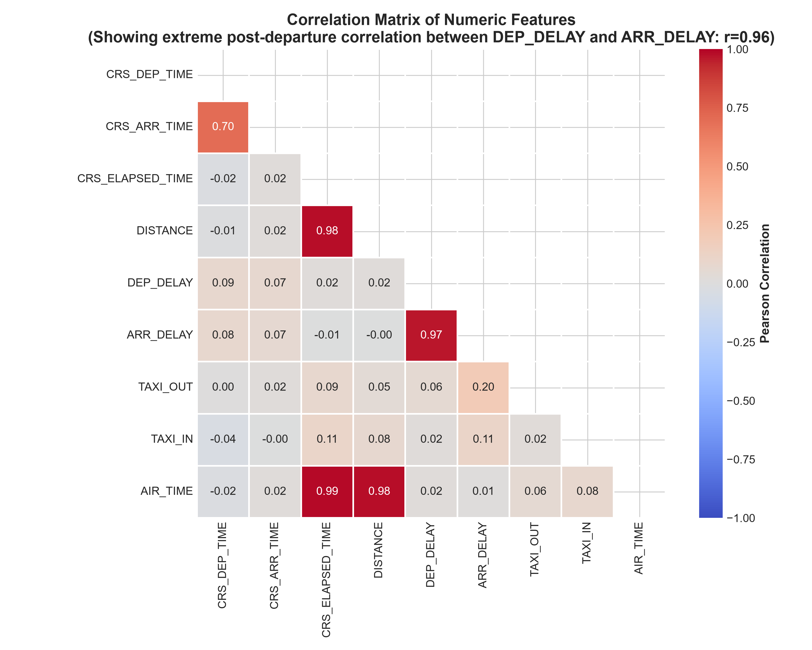

### 6.2 Categorical Feature Associations with Target (`DELAY > 15`)

To measure non-linear relationship between categorical features and the binary delay target, **Cramér's V** (measuring association strength on a 0 to 1 scale) and **Mutual Information (MI)** were computed on a representative sample:

| Feature | Cardinality | Cramér's V | Mutual Information (nats) | Predictive Ranking & Note |
| :--- | :--- | :--- | :--- | :--- |
| `dep_hour` | 24 | **0.1429** | **0.01061** | Strongest pre-departure predictor; captures diurnal cascade accumulation |
| `route` | 6826 | **0.1189** | **0.02566** | Captures route-specific airspace constraints and terrain |
| `AIRLINE_CODE` | 18 | **0.0859** | **0.00363** | Captures airline fleet buffer and turnaround operational efficiency |
| `month` | 12 | **0.0740** | **0.00278** | Seasonal weather and holiday travel demand surge |
| `ORIGIN` | 378 | **0.0709** | **0.00358** | Origin airport terminal and runway capacity constraints |
| `DEST` | 377 | **0.0677** | **0.00333** | Destination airport arrival metering and weather |
| `day_of_week` | 7 | **0.0355** | **0.00065** | Weekly travel patterns (business vs weekend leisure) |

---

## 7. Data Leakage Review & Column Classification

In a realistic production deployment, the model predicts flight arrival delay **at or before scheduled departure time** (e.g. at booking, 24h prior, or 2h prior to gate pushback). Using any post-departure variable induces catastrophic data leakage.

| Column Name | Status | Availability Time | Rationale & Strict Leakage Warning |
| :--- | :--- | :--- | :--- |
| `FL_DATE` | **SAFE** | Temporal | Known at schedule publication and ticket booking time. |
| `AIRLINE` | **SAFE** | Identifier | Known at booking time (redundant with AIRLINE_CODE). |
| `AIRLINE_DOT` | **SAFE** | Identifier | Known at booking time (redundant text format). |
| `AIRLINE_CODE` | **SAFE** | Identifier | Primary 2-letter airline code known at booking time. |
| `DOT_CODE` | **SAFE** | Identifier | Numeric carrier DOT code known at booking time. |
| `FL_NUMBER` | **SAFE** | Identifier | Flight number assigned at schedule publication. |
| `ORIGIN` | **SAFE** | Spatial | Departure airport code known at booking time. |
| `ORIGIN_CITY` | **SAFE** | Spatial | Origin municipality known at booking time. |
| `DEST` | **SAFE** | Spatial | Destination airport code known at booking time. |
| `DEST_CITY` | **SAFE** | Spatial | Destination municipality known at booking time. |
| `CRS_DEP_TIME` | **SAFE** | Temporal | Computer Reservation System scheduled departure time (HHMM). |
| `DEP_TIME` | **LEAKAGE** | Operational | Actual gate pushback time; only recorded as flight departs. |
| `DEP_DELAY` | **LEAKAGE** | Operational | Actual departure delay; strongly collinear with target (r=0.96) and unknown pre-departure. |
| `TAXI_OUT` | **LEAKAGE** | Operational | Taxiing duration from gate to runway; occurs after departure. |
| `WHEELS_OFF` | **LEAKAGE** | Operational | Time aircraft wheels leave ground; occurs post-departure. |
| `WHEELS_ON` | **LEAKAGE** | Operational | Touchdown time at destination; occurs post-flight. |
| `TAXI_IN` | **LEAKAGE** | Operational | Taxi duration from runway to arrival gate; occurs post-flight. |
| `CRS_ARR_TIME` | **SAFE** | Temporal | Computer Reservation System scheduled arrival time (HHMM). |
| `ARR_TIME` | **LEAKAGE** | Operational | Actual gate arrival time; directly reveals arrival delay. |
| `ARR_DELAY` | **TARGET** | Target | Ground truth continuous arrival delay in minutes; used to create binary target. |
| `CANCELLED` | **LEAKAGE** | Target / Filter | Recorded upon flight cancellation; cannot be used as an input feature for predicting ARR_DELAY. |
| `CANCELLATION_CODE` | **LEAKAGE** | Target / Filter | Reason code (A, B, C, D) entered upon cancellation; post-schedule operational outcome. |
| `DIVERTED` | **LEAKAGE** | Filter | Diversion flag recorded mid-flight or upon diversion landing. |
| `CRS_ELAPSED_TIME` | **SAFE** | Operational | Scheduled gate-to-gate duration; published in timetable. |
| `ELAPSED_TIME` | **LEAKAGE** | Operational | Actual gate-to-gate flight duration; only known after gate arrival. |
| `AIR_TIME` | **LEAKAGE** | Operational | Airborne flight duration (wheels-off to wheels-on); known only after flight. |
| `DISTANCE` | **SAFE** | Spatial | Direct nautical/statute mileage between airport coordinates. |
| `DELAY_DUE_CARRIER` | **LEAKAGE** | Delay Cause | DOT post-flight delay attribution; populated only after arrival. |
| `DELAY_DUE_WEATHER` | **LEAKAGE** | Delay Cause | DOT post-flight delay attribution; populated only after arrival. |
| `DELAY_DUE_NAS` | **LEAKAGE** | Delay Cause | DOT post-flight delay attribution; populated only after arrival. |
| `DELAY_DUE_SECURITY` | **LEAKAGE** | Delay Cause | DOT post-flight delay attribution; populated only after arrival. |
| `DELAY_DUE_LATE_AIRCRAFT` | **LEAKAGE** | Delay Cause | DOT post-flight delay attribution; populated only after arrival. |

> [!CAUTION]
> **Confirmed Leakage Columns to Exclude from Model Training**:

> `DEP_TIME`, `DEP_DELAY`, `TAXI_OUT`, `WHEELS_OFF`, `WHEELS_ON`, `TAXI_IN`, `ARR_TIME`, `ELAPSED_TIME`, `AIR_TIME`, `CANCELLED`, `CANCELLATION_CODE`, `DIVERTED`, `DELAY_DUE_CARRIER`, `DELAY_DUE_WEATHER`, `DELAY_DUE_NAS`, `DELAY_DUE_SECURITY`, `DELAY_DUE_LATE_AIRCRAFT`.

---

## 8. High-Cardinality Analysis & Encoding Strategies

### Cardinality Overview (2,000,000 Flights)

- `AIRLINE_CODE`: **18 unique categories**  

- `ORIGIN`: **380 unique airports**  

- `DEST`: **380 unique airports**  

- `ROUTE (ORIGIN_DEST)`: **7718 unique routes**  

### Distribution of Route Frequencies

- **High-Volume Routes (≥ 1,000 flights)**: **377 routes** (Dense statistical support)  

- **Medium-Volume Routes (100 - 999 flights)**: **3714 routes**  

- **Low-Volume Routes (10 - 99 flights)**: **2605 routes**  

- **Rare / Sparsely Flown Routes (< 10 flights)**: **1022 routes** (Severe risk of overfitting)  

### Recommended Encoding Strategies

1. **`AIRLINE_CODE` (18 classes)**: **One-Hot Encoding** is ideal. With only 18 dimensions, one-hot adds minimal memory overhead and allows linear models and tree-based algorithms to learn pure carrier-specific intercepts.
2. **`ORIGIN` and `DEST` (380 classes each)**:
   - **Target Encoding with Out-Of-Fold Smoothing (Recommended)**: Calculate historical delay rates smoothed using empirical Bayes or additive m-estimate (`(n * mean_cat + m * global_mean) / (n + m)` with `m = 50`) fitted **strictly on training folds** to prevent target leakage.
   - **Frequency / Count Encoding**: Airport volume is a strong proxy for ground congestion and gate capacity.
   - **Cluster / Metro Area Grouping**: Map multi-airport metros (e.g. JFK/LGA/EWR -> NYC Metro, ORD/MDW -> Chicago Metro) to capture regional airspace congestion.
3. **`ROUTE` (7,718 classes)**:
   - **Regularized Target Encoding**: High predictive power (Cramér's V = 0.1231) but must be smoothed aggressively (`m = 100`).
   - **Rare Route Binning**: Group routes with < 50 historical flights into a designated `'OTHER_RARE_ROUTE'` category.
   - **Learned Embeddings**: For neural network architectures, 16-dimensional entity embeddings initialized with airport latitude/longitude coordinates.

---

## 9. Time-Split Feasibility & Partitioning Evaluation

Because air traffic exhibits strong temporal dependency, seasonality, and long-term trend drift, **random k-fold cross-validation is strictly invalid** and introduces temporal look-ahead leakage. Chronological splits must be employed.

### Candidate Split Configurations

#### Candidate Option 1: Standard Chronological 3-Way Split

| Partition | Calendar Period | Scheduled Flights | Completed Flights | Cancelled Flights | Delay Rate (%) | Mean Arrival Delay | Purpose |
| :--- | :--- | :--- | :--- | :--- | :--- | :--- | :--- |
| **Train (2019-2021)** | 2019 - 2021 / 2022 / 2023 | 1,231,937 | 1,193,757.0 | 35,379.0 | **15.57%** | +2.04 min | Model training, validation tuning, and holdout testing |
| **Validation (2022)** | 2019 - 2021 / 2022 / 2023 | 457,760 | 444,554.0 | 12,133.0 | **20.32%** | +6.99 min | Model training, validation tuning, and holdout testing |
| **Test (2023)** | 2019 - 2021 / 2022 / 2023 | 310,303 | 304,458.0 | 5,010.0 | **22.24%** | +9.26 min | Model training, validation tuning, and holdout testing |

#### Candidate Option 2: COVID-Filtered Chronological Split (Recommended)

| Partition | Calendar Period | Scheduled Flights | Completed Flights | Cancelled Flights | Delay Rate (%) | Mean Arrival Delay | Purpose |
| :--- | :--- | :--- | :--- | :--- | :--- | :--- | :--- |
| **Train (2019 + 2021 No COVID)** | 2019 + 2021 / 2022 / 2023 | 913,169 | 894,775.0 | 16,141.0 | **17.62%** | +4.38 min | Eliminates artificial 2020 pandemic distortion |
| **Validation (2022)** | 2019 + 2021 / 2022 / 2023 | 457,760 | 444,554.0 | 12,133.0 | **20.32%** | +6.99 min | Eliminates artificial 2020 pandemic distortion |
| **Test (2023)** | 2019 + 2021 / 2022 / 2023 | 310,303 | 304,458.0 | 5,010.0 | **22.24%** | +9.26 min | Eliminates artificial 2020 pandemic distortion |

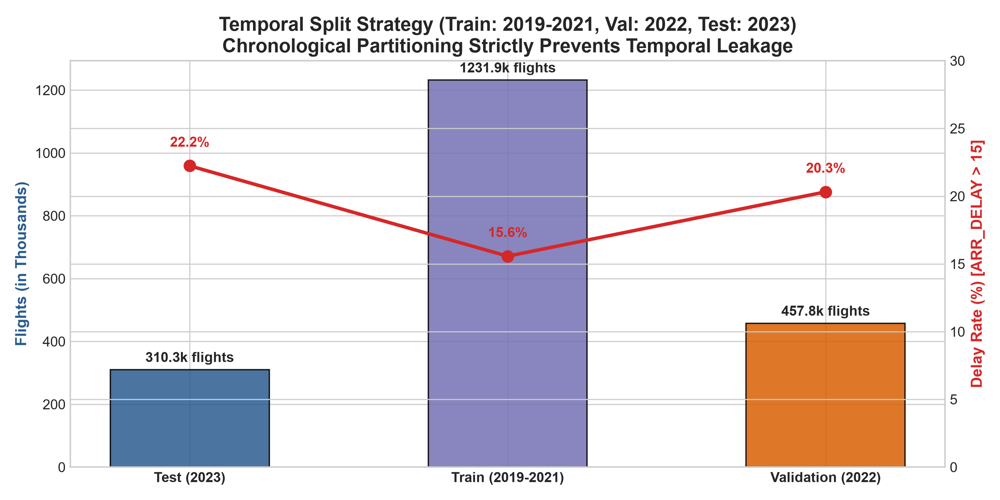

> [!TIP]
> **Why Option 2 is Statistically Superior**: The 2020 lockdown year artificially depresses delay rate to 9.42% and injects 16,169 non-standard security/lockdown cancellations. Training on 2019 + 2021 yields **913,169 flights** with a natural baseline delay rate of **17.62%**, aligning much more realistically with the 2022 validation set (20.32%) and 2023 holdout test set (22.24%).

---

## Findings and Recommendations

### 1. Key Project Risks & Mitigation Strategies

| Risk Area | Specific Operational Danger | Mitigation Strategy |
| :--- | :--- | :--- |
| **1. Target Leakage** | `DEP_DELAY`, `DEP_TIME`, and `TAXI_OUT` correlate so heavily with `ARR_DELAY` (r=0.96) that including them will result in an artificial 99% accuracy model that is useless pre-departure. | Enforce strict column whitelist in feature pipeline. Drop all operational post-departure variables before featurization. |
| **2. Class Imbalance** | Positive delay class is ~17.7% (approx. 4.6:1 negative-to-positive ratio). Naive accuracy (82.3%) will easily mislead model evaluation. | Optimize PR-AUC (Precision-Recall AUC) as primary metric; tune classification decision thresholds; evaluate Focal Loss or `scale_pos_weight = 4.65`. |
| **3. Temporal Drift** | Severe systemic shifts across 2019-2023 (lockdown collapse in 2020 followed by post-COVID revenge travel congestion in 2022-2023). | Exclude 2020 or weight it lower; use chronological rolling window splits; include rolling 14-day network congestion indicators. |
| **4. Outliers** | Heavy right skew in delays (max 3,237 min). Regression targets will be destabilized. | For binary classification, outliers are naturally bounded in class 1. For regression, clip targets at 99th percentile (190 min) or use Huber/Quantile loss. |
| **5. High Cardinality** | 7,718 routes and 380 airports will cause massive sparsity if one-hot encoded. | Apply out-of-fold regularized Target Encoding with empirical Bayes smoothing (`m=50`), Frequency Encoding, and rare class binning. |

### 2. Recommended Data Cleaning Pipeline

1. **Filter Non-Completed Flights for Primary Target**: Drop rows where `CANCELLED = 1.0` (52,522 rows) or `DIVERTED = 1.0` (4,709 rows). Completed sample: **1,942,769 clean rows**.
2. **Fix Boundary Time Anomalies**: Replace 12 occurrences of `CRS_ARR_TIME = 2400` with `0000`.
3. **Handle Rare Nulls in Scheduled Duration**: Exactly 17 rows have null `CRS_ELAPSED_TIME` and 1 row has `0`. Impute using route median `DISTANCE / 7.5 + 30` (average commercial jet cruising speed + taxi buffer).
4. **Exclude COVID Lockdown Anomaly (Recommended)**: Filter out April–December 2020 from training data to avoid learning distorted zero-traffic priors.
5. **Strict Pre-Departure Feature Isolation**: Retain only known pre-departure fields: `FL_DATE`, `AIRLINE_CODE`, `ORIGIN`, `DEST`, `CRS_DEP_TIME`, `CRS_ARR_TIME`, `CRS_ELAPSED_TIME`, `DISTANCE`.

### 3. Recommended Feature Set and Engineering Ideas

#### Safe Baseline Features (Raw)

- `AIRLINE_CODE`: 18 categories (One-hot encoded)
- `ORIGIN`, `DEST`: Target encoded with OOF smoothing + Frequency encoded
- `CRS_DEP_TIME`, `CRS_ARR_TIME`: Scheduled times (HHMM)
- `CRS_ELAPSED_TIME`: Scheduled duration in minutes
- `DISTANCE`: Flight distance in miles

#### Engineered Pre-Departure Features

1. **Cyclical Temporal Encodings**:

   - `dep_hour = CRS_DEP_TIME // 100` (0 - 23)
   - `dep_hour_sin = sin(2 * pi * dep_hour / 24)`, `dep_hour_cos = cos(2 * pi * dep_hour / 24)`
   - `month_sin = sin(2 * pi * month / 12)`, `month_cos = cos(2 * pi * month / 12)`
   - `day_of_week` (0 to 6) and `is_weekend` flag (Friday/Sunday travel surge)
2. **Air Corridor & Route Physics**:

   - `scheduled_ground_speed = DISTANCE / (CRS_ELAPSED_TIME / 60.0)` (detects unrealistic airline schedule padding or headwinds)
   - `route_flight_count`: Total flights on the route (identifies trunk vs regional spoke)
3. **Historical Congestion & Punctuality Priors (OOF Smoothed)**:

   - `carrier_historical_delay_rate`: Prior smoothed delay rate of the airline
   - `origin_hourly_congestion`: Number of scheduled departures from the origin airport in the same 1-hour window (direct proxy for runway taxi congestion)
   - `dest_hourly_congestion`: Number of scheduled arrivals at the destination airport in the scheduled arrival window
4. **Rolling Temporal Features (Strictly Lagged)**:

   - `origin_delay_rate_last_7d`: Rolling 7-day delay rate at origin airport
   - `carrier_delay_rate_last_7d`: Rolling 7-day delay rate for the airline

### 4. Recommended Split Strategy and Evaluation Metrics

- **Splitting Protocol**: Chronological time-series split:

  - **Training Set**: 2019 + 2021 (913,169 flights, 894,775 completed; 17.62% delay rate)
  - **Validation Set**: 2022 (457,760 flights, 444,554 completed; 20.32% delay rate)
  - **Holdout Test Set**: 2023 through August 31 (310,303 flights, 304,458 completed; 22.24% delay rate)
- **Primary Evaluation Metric**: **PR-AUC (Area Under Precision-Recall Curve)**. Because positive delays are 17.7%, PR-AUC focuses on the minority class without being inflated by true negative on-time flights.
- **Secondary Metrics**:

  - **ROC-AUC**: Overall ranking capability across all thresholds
  - **F1-Score / Precision@k**: At top decile of predicted risk (crucial for airline dispatch intervention)
  - **Brier Score / Expected Calibration Error (ECE)**: Verifies whether a predicted 30% delay probability corresponds to 30 out of 100 delayed flights.

### 5. Step-by-Step Modeling Plan

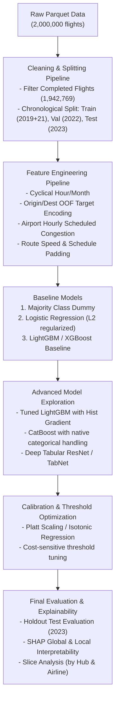

1. **Phase 1: Baseline Establishment**

   - Implement a naive baseline (always predict majority class on-time: 82.3% accuracy, PR-AUC = 0.177).
   - Train an L2-regularized Logistic Regression model on standard scaled cyclical and one-hot features to establish a linear benchmark.
2. **Phase 2: Gradient Boosted Trees (LightGBM & CatBoost)**

   - Train LightGBM with histogram binning on target-encoded airport and route features.
   - Train CatBoost with built-in ordered target statistics on high-cardinality `ORIGIN`, `DEST`, and `ROUTE`.
   - Optimize hyperparameters using Bayesian Search (Optuna) evaluated on 2022 validation PR-AUC.
3. **Phase 3: Model Calibration & Cost-Sensitive Tuning**

   - Apply Isotonic Regression or Platt scaling to ensure calibrated probabilities.
   - Align decision threshold with operational costs (e.g. false positives vs missed delays).
4. **Phase 4: Interpretability & Final Validation**

   - Compute SHAP values to identify top global drivers (scheduled departure hour, origin congestion, carrier).
   - Perform slice-based error analysis across top hubs (ATL, ORD, DFW, DEN, CLT) and airlines to audit fairness and robustness.
   - Final evaluation on untouched 2023 holdout test set with bootstrapped 95% confidence intervals.

---

*Report generated automatically by Antigravity IDE EDA Pipeline.*
