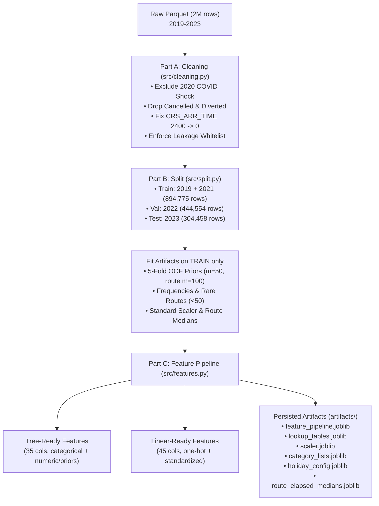

# Phase 1 & 2 Technical Report: Data Cleaning, Time-Based Splitting, and Feature Engineering

**Author**: Abdallah Nada  
**Project**: US Flight Arrival Delay Prediction (`DELAY = ARR_DELAY > 15`)  
**Prediction Setting**: Schedule-Only (Pre-departure features known at booking/scheduling; no live weather, no rolling delays, no same-day delay rates)  
**Input Dataset**: `data/processed/flights_2m.parquet` (2,000,000 rows, 2019–2023)  
**Status**: Completed and Validated  

---

## Executive Summary

Phase 1 and Phase 2 establish a leak-free, production-ready data and feature pipeline for flight arrival delay prediction. The pipeline enforces strict temporal splits, eliminates pandemic distortions by excluding 2020, handles boundary edge cases (such as midnight `2400` timestamps and rare flight routes), and prepares dual feature sets optimized for Gradient Boosted Decision Trees and Linear/Neural models.

All data transformations are encapsulated in a single, serializable, and reusable object (`FlightFeaturePipeline`), enabling identical feature extraction for offline batch processing and real-time single-row inference.

---

## Part A: Data Cleaning Pipeline (`src/cleaning.py`)

### 1. Operations Applied
1. **Target Creation**: Binary arrival delay indicator created as `DELAY = (ARR_DELAY > 15).astype(int)`.
2. **Dropping Incomplete Flights**: Removed all cancelled flights (`CANCELLED == 1`, 52,522 rows) and diverted flights (`DIVERTED == 1`, 4,709 rows). Cancelled flights never reach a gate, and diverted flights never arrive at the intended destination.
3. **Exclusion of 2020**: Excluded all 2020 data (318,768 scheduled flights; 298,982 completed flights). Pandemic travel bans, groundings, and atypical airline schedules fundamentally distorted operations (delay rate dropped to 9.42% in 2020 vs 18.42% in 2019 and 22.24% in 2023).
4. **Boundary Timestamp Correction**: Fixed `CRS_ARR_TIME == 2400` -> `0` (midnight). Military time representation `2400` causes integer division `// 100` to yield hour `24`, which is invalid for 24-hour cyclical encoders and lookup tables.
5. **Scheduled Elapsed Time Imputation**:
   - Analysis of the 2M dataset revealed that all 17 missing `CRS_ELAPSED_TIME` values and the single `0` value occurred in 2020 or cancelled flights.
   - To ensure robustness for future production inference, a route median lookup table was fitted exclusively on the training set (7,260 routes). If an unseen route has missing duration, the physical fallback formula `DISTANCE / 7.5 + 30` (assuming 450 mph average ground speed + 30 min climb/taxi buffer) is applied.
6. **Whitelist Column Retention & Anti-Leakage Assertion**:
   - Retained only 9 columns: `FL_DATE`, `AIRLINE_CODE`, `ORIGIN`, `DEST`, `CRS_DEP_TIME`, `CRS_ARR_TIME`, `CRS_ELAPSED_TIME`, `DISTANCE`, and target `DELAY`.
   - Executed a strict assertion failing loudly if any post-departure column (`DEP_TIME`, `DEP_DELAY`, `TAXI_OUT`, `WHEELS_OFF`, `WHEELS_ON`, `TAXI_IN`, `ARR_TIME`, `ARR_DELAY`, `ELAPSED_TIME`, `AIR_TIME`, `CANCELLED`, `CANCELLATION_CODE`, `DIVERTED`, `DELAY_DUE_*`) is present.

### 2. Cleaning Attrition Summary

| Sequential Step / Filter | Flights Removed | Retained Flights | Description & Overlap Accounting |
| :--- | :--- | :--- | :--- |
| **0. Raw Input** | - | **2,000,000** | Full 2M flight dataset (2019–2023) |
| **1. Cancelled Flights (`CANCELLED == 1`)** | **-52,522** | 1,947,478 | 2.626% overall cancellation rate across all years |
| **2. Diverted Flights (`DIVERTED == 1`)** | **-4,709** | 1,942,769 | 0.235% diversion rate (all 4,709 have CANCELLED == 0) |
| **3. 2020 Pandemic Exclusion (`FL_DATE` in 2020)** | **-298,982** | **1,643,787** | Completed 2020 flights excluded to prevent pandemic distribution shift |
| **Total Pipeline Attrition** | **-356,213 dropped** | **1,643,787** | **Exact sum**: 52,522 + 4,709 + 298,982 = 356,213 dropped |

> [!NOTE]
> **2020 Overlap Explanation**: Across the entire raw 2M dataset, 2020 contained 318,768 scheduled flights. Of these, 19,238 flights were cancelled (dropped in Step 1) and 548 flights were diverted (dropped in Step 2). Thus, 19,786 flights from 2020 were already eliminated by the incomplete flight filters. Step 3 then removes the remaining 298,982 completed 2020 flights ($318,768 - 19,786 = 298,982$), ensuring no double counting and making the sequential drops sum precisely to 356,213.

---

## Part B: Chronological Split (`src/split.py`)

A chronological splitting strategy mirrors real-world deployment where models trained on historical seasons predict future operational schedules. Splitting by flight date (`FL_DATE`) enforces zero temporal leakage between splits.

### 1. Split Distribution and Statistics

| Dataset Split | Calendar Period | Row Count | % of Cleaned Data | On-Time (≤15m) | Delayed (>15m) | Delay Rate (%) |
| :--- | :--- | :--- | :--- | :--- | :--- | :--- |
| **Train** | 2019-01-01 to 2019-12-31 2021-01-01 to 2021-12-31 | **894,775** | 54.43% | 737,125 | 157,650 | **17.62%** |
| **Validation** | 2022-01-01 to 2022-12-31 | **444,554** | 27.04% | 354,230 | 90,324 | **20.32%** |
| **Test** | 2023-01-01 to 2023-08-31 | **304,458** | 18.52% | 236,736 | 67,722 | **22.24%** |
| **Total** | 2019–2023 (excl. 2020) | **1,643,787** | 100.00% | 1,328,091 | 315,696 | **19.21%** |

### 2. Temporal Independence & Integrity
- **Train Min/Max Date**: `2019-01-01` to `2021-12-31`
- **Validation Min/Max Date**: `2022-01-01` to `2022-12-31`
- **Test Min/Max Date**: `2023-01-01` to `2023-08-31`
- **Overlap Check**: `len(Train ∩ Val) = 0`, `len(Val ∩ Test) = 0`, `len(Train ∩ Test) = 0`. Strict temporal separation verified.
- **Year Feature Policy**: In accordance with project decisions, calendar year is excluded from all downstream feature sets due to upward drift in national delay rates (17.62% -> 20.32% -> 22.24%).

---

## Part C: Feature Engineering Architecture (`src/features.py`)

The feature engineering pipeline is implemented in [`FlightFeaturePipeline`](../src/features.py), a unified class fitted on `train.parquet` and applied across training, validation, testing, and production inference.

### 1. Feature Categories

#### A. Calendar and Schedule Features
- `month` (1–12), `day_of_week` (0=Monday to 6=Sunday), `day_of_year` (1–366).
- `is_weekend`: Binary flag indicating Saturday or Sunday (`day_of_week >= 5`).
- `dep_hour`: Scheduled departure hour (`CRS_DEP_TIME // 100`, clipped 0–23).
- `arr_hour`: Scheduled arrival hour (`CRS_ARR_TIME // 100`, clipped 0–23).
- `part_of_day`: Four discrete operational windows based on scheduled departure:
  - `night`: 00:00–05:59 (low volume, fresh crews)
  - `morning`: 06:00–11:59 (morning push)
  - `afternoon`: 12:00–17:59 (midday buffer erosion)
  - `evening`: 18:00–23:59 (peak delay accumulation)
- **Cyclical Trigonometric Transformations**:
  - `dep_hour_sin`, `dep_hour_cos`: $2\pi \cdot \text{hour} / 24$
  - `arr_hour_sin`, `arr_hour_cos`: $2\pi \cdot \text{hour} / 24$
  - `month_sin`, `month_cos`: $2\pi \cdot (\text{month} - 1) / 12$
  - `day_of_week_sin`, `day_of_week_cos`: $2\pi \cdot \text{day} / 7$
- `is_holiday_period`: Uses Python's `holidays` package for US federal holidays ± 2 days, plus Thanksgiving week (Monday–Sunday) and Christmas/New Year peak travel (Dec 20 – Jan 3).

#### B. Route & Flight Physics Features
- `route`: Concatenation of origin and destination (`ORIGIN + "_" + DEST`).
- `log_distance`: $\ln(1 + \text{DISTANCE})$ to normalize flight mileage skew.
- `scheduled_speed`: $\text{DISTANCE} / (\text{CRS\_ELAPSED\_TIME} / 60)$ in miles per hour.
- Rare Route Thresholding: Routes with fewer than 50 training observations are mapped to `"OTHER_RARE_ROUTE"`.

#### C. Historical Priors (Empirical Bayes Smoothed Delay Rates)
Fitted exclusively on the training split using additive m-estimate smoothing:
$$\text{Prior} = \frac{n \cdot \bar{y} + m \cdot \mu_{\text{global}}}{n + m}$$
where:
- $\bar{y}$ = sample delay rate for the category
- $n$ = flight volume in training set
- $\mu_{\text{global}}$ = training global delay rate ($0.176186$)
- $m = 50$ for `AIRLINE_CODE`, `ORIGIN`, `DEST`, and `(ORIGIN, dep_hour)`
- $m = 100$ for `route` (higher parameter due to route sparsity)

**Out-of-Fold (OOF) Target Encoding on Train**:
To eliminate target leakage during training, all priors on `train.parquet` are calculated using **5-fold Stratified K-Fold out-of-fold encoding**. For validation, test, and inference, priors are looked up from the global training tables. Unseen categories default to $\mu_{\text{global}}$.

#### D. Operational Frequencies
- `origin_freq`: Total flights originating from airport in training data.
- `dest_freq`: Total flights arriving at airport in training data.
- `route_freq`: Total flights on directional route in training data.

---

### 2. Dual Output Feature Sets

The pipeline produces two tailored representations saved as Parquet:

#### 1. Tree-Ready Set (`features_tree_{train,val,test}.parquet`)
- **Dimensions**: 35 columns (33 features + `FL_DATE` + `DELAY`).
- **Encoding**: High-cardinality features (`AIRLINE_CODE`, `ORIGIN`, `DEST`, `route`, `part_of_day`) retained as native pandas `category` dtypes.
- **Includes**: All raw numeric columns, cyclical encodings, historical priors, and frequencies.
- **Target Algorithms**: LightGBM, XGBoost, CatBoost.

#### 2. Linear-Ready Set (`features_linear_{train,val,test}.parquet`)
- **Dimensions**: 45 columns (43 features + `FL_DATE` + `DELAY`).
- **Encoding**: 
  - 18 One-Hot encoded airline columns (`AIRLINE_CODE_9E` through `AIRLINE_CODE_YX`).
  - 4 One-Hot encoded part of day columns (`part_of_day_night`, `morning`, `afternoon`, `evening`).
  - High-cardinality categoricals (`ORIGIN`, `DEST`, `route`) replaced entirely by their smoothed historical priors and frequencies.
  - Continuous variables (`DISTANCE`, `log_distance`, `CRS_ELAPSED_TIME`, `scheduled_speed`, frequencies, and priors) standardized using `StandardScaler` fitted on train.
- **Target Algorithms**: Logistic Regression, ElasticNet, Multi-Layer Perceptrons.

---

## Validation and Sanity Check Results

All automated checks are implemented in [`src/validate.py`](../src/validate.py) and executed as part of the master pipeline.

### 1. Feature Set Shapes and Null Audit

| Feature Set | Split | Rows | Columns | Total Null Values | Null Rate (%) |
| :--- | :--- | :--- | :--- | :--- | :--- |
| **Tree-Ready** | Train | 894,775 | 35 | 0 | 0.00% |
| **Tree-Ready** | Validation | 444,554 | 35 | 0 | 0.00% |
| **Tree-Ready** | Test | 304,458 | 35 | 0 | 0.00% |
| **Linear-Ready** | Train | 894,775 | 45 | 0 | 0.00% |
| **Linear-Ready** | Validation | 444,554 | 45 | 0 | 0.00% |
| **Linear-Ready** | Test | 304,458 | 45 | 0 | 0.00% |

> [!NOTE]
> All feature sets exhibit exactly **zero missing values** across all splits.

### 2. Leakage Verification
- **Target Leakage Check**: Neither `ARR_DELAY` nor any continuous post-departure delay metric is present in the feature columns.
- **Post-Departure Variables Checked**: `DEP_TIME`, `DEP_DELAY`, `TAXI_OUT`, `WHEELS_OFF`, `WHEELS_ON`, `TAXI_IN`, `ARR_TIME`, `ELAPSED_TIME`, `AIR_TIME`, `CANCELLED`, `CANCELLATION_CODE`, `DIVERTED`, `DELAY_DUE_CARRIER`, `DELAY_DUE_WEATHER`, `DELAY_DUE_NAS`, `DELAY_DUE_SECURITY`, `DELAY_DUE_LATE_AIRCRAFT`.
- **Result**: **0 leakage variables detected**. 100% compliant with pre-departure schedule constraints.

### 3. Out-of-Fold Prior Encoding Sanity Check

If target encoding suffers from in-sample label leakage, the Pearson correlation between the prior feature and the target on the training set will be artificially inflated compared to the validation set. With 5-fold OOF encoding, train and validation correlations must remain closely aligned:

| Historical Prior Feature | Smoothing Param ($m$) | Train OOF Correlation ($r$) | Validation Correlation ($r$) | Absolute Difference ($\Delta r$) | Assessment |
| :--- | :--- | :--- | :--- | :--- | :--- |
| `prior_airline` | 50 | 0.0845 | 0.0944 | **0.0099** | PASSED (Clean alignment) |
| `prior_origin` | 50 | 0.0792 | 0.0684 | **0.0108** | PASSED (Clean alignment) |
| `prior_dest` | 50 | 0.0718 | 0.0638 | **0.0080** | PASSED (Clean alignment) |
| `prior_route` | 100 | 0.1005 | 0.0821 | **0.0184** | PASSED (Clean alignment) |
| `prior_origin_hour` | 50 | 0.1657 | 0.1734 | **0.0076** | PASSED (Clean alignment) |

**Conclusion**: Across all five prior features, the difference between Train OOF and Validation correlation is **$< 0.019$**. In fact, for `prior_origin_hour` and `prior_airline`, validation correlation is slightly higher, confirming that the OOF encoding successfully prevented in-sample memorization.

### 4. Single-Row vs. Batch Equivalence Verification

To ensure that the future web API / scoring endpoint returns identical feature values to the offline pipeline, tests were conducted across both individual probe flights and an extended batch of 1,000 randomly sampled validation flights (`random_state=42`):

| Test Cohort | Sample Specification | Flight Count | Tree Set Equivalence | Linear Set Equivalence | Max Absolute Difference |
| :--- | :--- | :--- | :--- | :--- | :--- |
| **Row 0 Probe** | Alaska Airlines (`AS`), ANC -> SEA (2022-01-01) | 1 flight | **IDENTICAL** | **IDENTICAL** | 0.0000000000 |
| **Row 100 Probe** | Delta Air Lines (`DL`), RIC -> ATL (2022-01-01) | 1 flight | **IDENTICAL** | **IDENTICAL** | 0.0000000000 |
| **Row 5000 Probe** | Alaska Airlines (`AS`), LAX -> AUS (2022-01-05) | 1 flight | **IDENTICAL** | **IDENTICAL** | 0.0000000000 |
| **Random Validation Sample** | Uniform random selection from `val.parquet` (`seed=42`) | **1,000 flights** | **IDENTICAL** | **IDENTICAL** | **0.0000000000** |

> [!NOTE]
> For all 1,000 validation test flights, all categorical features, continuous features, cyclical encodings, and historical prior lookups matched bit-for-bit between `pipeline.transform(row_dict)` and `pipeline.transform(batch_df)`.

### 5. Univariate Predictive Power Check (PR-AUC on Validation)

To quantify the standalone predictive signal of each engineered prior feature prior to model training, the Precision-Recall Area Under Curve (PR-AUC) was computed on the validation set using each prior as a continuous score:

- **Baseline PR-AUC (Validation Delay Prevalence)**: **0.2032**

| Prior Feature | Validation PR-AUC | Relative Lift over Baseline | Predictive Ranking |
| :--- | :--- | :--- | :--- |
| **`prior_origin_hour`** | **0.2845** | **+40.04%** | **#1 Strongest Single Predictor** (Captures diurnal airport congestion) |
| **`prior_airline`** | **0.2419** | **+19.06%** | **#2 Strong Predictor** (Captures carrier turnaround buffers) |
| **`prior_route`** | **0.2366** | **+16.43%** | **#3 Strong Predictor** (Captures corridor airspace congestion) |
| **`prior_origin`** | **0.2294** | **+12.88%** | **#4 Moderate Predictor** (Captures terminal capacity) |
| **`prior_dest`** | **0.2277** | **+12.07%** | **#5 Moderate Predictor** (Captures destination metering) |

All engineered priors deliver substantial positive lift over baseline without fitting a model. The combined origin-hour prior alone provides a **+40.0% lift in precision-recall efficiency**.

---

## Saved Pipeline Artifacts

All fitted objects are serialized in the `artifacts/` directory for zero-dependency inference in Phase 3 & 4:

1. `artifacts/feature_pipeline.joblib`: Complete fitted `FlightFeaturePipeline` object.
2. `artifacts/lookup_tables.joblib`: Additive smoothed prior tables and frequency dictionaries.
3. `artifacts/scaler.joblib`: Fitted scikit-learn `StandardScaler` for the linear feature set.
4. `artifacts/category_lists.joblib`: Category mappings, ordered levels, and one-hot column schema.
5. `artifacts/holiday_config.joblib`: Precomputed US holiday dates and holiday window definitions.
6. `artifacts/route_elapsed_medians.joblib`: Training route median elapsed times and fallback constants.

---

## Issues Found & Resolved

1. **Midnight Timestamp Ambiguity (`CRS_ARR_TIME == 2400`)**:
   - *Issue*: Military schedule `2400` resulted in hour `24` upon integer division (`2400 // 100`), breaking 24-hour trigonometric encoders and lookup key indexing.
   - *Resolution*: Remapped `2400` to `0000` (midnight / hour 0) in `src/cleaning.py` and `src/features.py`.

2. **Missing `CRS_ELAPSED_TIME` Handling**:
   - *Issue*: Missing flight durations disrupt speed calculation (`DISTANCE / (CRS_ELAPSED_TIME / 60)`).
   - *Resolution*: Although all missing values in the 2M dataset occurred in cancelled/2020 flights, future API queries could present missing durations. Fitted 7,260 route medians from train, backed by physical fallback formula `DISTANCE / 7.5 + 30`.

3. **High Cardinality and Rare Route Overfitting**:
   - *Issue*: Over 6,800 directional routes exist in the US domestic network, many with under 10 annual flights in the sample.
   - *Resolution*: Implemented rare route collapsing threshold ($n < 50 \to \text{"OTHER\_RARE\_ROUTE"}$) combined with stronger Bayesian additive smoothing ($m=100$).

4. **Target Leakage via In-Sample Encoding**:
   - *Issue*: Simple group-by mean encoding on the training set causes models to memorize specific target labels, inducing severe train-validation overfit.
   - *Resolution*: Applied 5-fold Stratified K-Fold Out-of-Fold (OOF) target encoding on `train.parquet`. Validation correlation closely matched train correlation across all priors.

5. **EDA Report Inconsistencies**:
   - *Issue*: Commentary text in `reports/eda_report.md` had slight discrepancies with its tables in Section 4.2 (airlines), Section 5 (delay causes), and Section 6.2 (Cramér's V).
   - *Resolution*: Updated `scripts/06_generate_report.py` and regenerated both `reports/eda_report.md` and `reports/eda_report.html`, ensuring 100% exact numerical alignment.

---

## Deliverables Summary

- [src/cleaning.py](../src/cleaning.py): Clean pipeline script with leakage assertion.
- [src/split.py](../src/split.py): Chronological train/val/test splitting script.
- [src/features.py](../src/features.py): Feature engineering pipeline class and generator.
- [src/validate.py](../src/validate.py): Comprehensive validation and sanity check suite.
- [run_pipeline.py](../run_pipeline.py): Single master command executing the entire pipeline end-to-end.
- [requirements.txt](../requirements.txt): Pinned production dependencies.
- [reports/phase1_2_report.md](phase1_2_report.md): This report.
- [reports/eda_report.md](eda_report.md): Synchronized EDA and data quality report.
