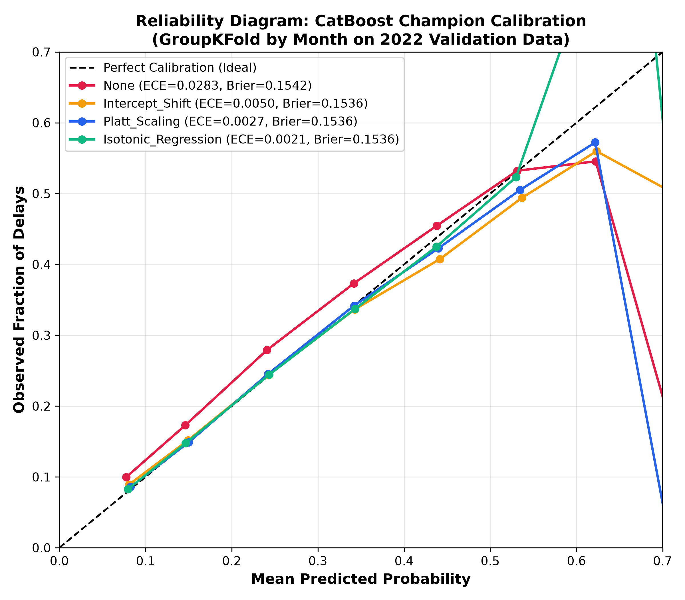

# Phase 4 Technical Report: Controlled Improvement, Tuning, and Calibration

**Author**: Abdallah Nada  
**Project**: US Flight Arrival Delay Prediction (`DELAY = ARR_DELAY > 15`)  
**Prediction Setting**: Pre-departure Schedule-Only (Strictly inference-computable from airline, origin, dest, date, scheduled times + historical train lookups)  
**Evaluation Protocol**: 2022 Validation Partition (444,554 completed flights). **Test set (2023) strictly untouched.**  
**Statistical Protocol**: Day-Clustered Block Bootstrap (250 resamples by `FL_DATE`, 365 day clusters). 95% Confidence Intervals for all metrics and paired difference significance tests.  
**Fixed Random Seed**: `42` applied across all partitioning, sampling, optimization, and bootstrapping.  
**Status**: Completed, Validated, and Persisted.

---

## Executive Summary

Phase 4 moves beyond heuristic feature ablation to establish a **rigorous statistical yardstick** (day-clustered bootstrapping), test **seven candidate schedule-only features**, perform **Bayesian hyperparameter optimization** with Optuna, evaluate **alternative model architectures (CatBoost and Ensembles)**, and implement **out-of-fold probability calibration**.

```mermaid
flowchart TD
    subgraph Part0["Part 0: Statistical Yardstick"]
        Yardstick["Day-Clustered Bootstrap (250 resamples, 365 days)<br/>Baseline Variant G: PR-AUC = 0.3232 [0.3098, 0.3360]"]
    end

    subgraph Part1["Part 1: Feature Experiments"]
        Feats["7 Schedule-Only Candidates Tested<br/>• prior_origin_month (Dropped, -0.00121, p=0.016)<br/>• prior_origin_dow_pod (+0.00009, CI spans 0)<br/>• prior_airline_hour (+0.00040, CI spans 0)<br/>• prior_airline_origin (+0.00066, CI spans 0)<br/>• prior_dest_arrhour (+0.00028, CI spans 0)<br/>• typical_dep_density (+0.00011, CI spans 0)<br/>• days_to_nearest_holiday (-0.00154, CI spans 0)<br/><b>Verdict: All 7 Candidates Dropped under CI Rule</b>"]
    end

    subgraph Part2["Part 2: LightGBM Tuning"]
        Tuning["Optuna 40 Trials on 50% Subsample<br/>Refit on 100% Train: PR-AUC = 0.3237<br/>Δ = +0.00051 [CI: -0.00028, +0.00136], p=0.240<br/><b>Verdict: Retain Simpler Baseline</b>"]
    end

    subgraph Part3["Part 3: Alternatives & Ensembles"]
        Alts["• CatBoost Priors Only: PR-AUC 0.3242 (+0.00098, p=0.040)<br/>• CatBoost Native Cats (ORIGIN, DEST, route):<br/><b>PR-AUC 0.3257, ROC-AUC 0.6571</b><br/><b>Δ = +0.00246 [CI: +0.00141, +0.00365], p=0.0000</b><br/>• Blend (LGBM + LR): 0.3220 (Dropped)<br/>• Blend (LGBM + CatBoost): 0.3245<br/><b>Winner: CatBoost Native Categoricals</b>"]
    end

    subgraph Part4["Part 4: Calibration"]
        Calib["GroupKFold by Month (12 folds in 2022)<br/>Platt Scaling chosen: ECE drops 0.0283 → 0.0027 (-90%)<br/>Brier drops 0.1542 → 0.1534 | LogLoss drops 0.4822 → 0.4793"]
    end

    subgraph Part5["Part 5: Deliverables & v2 Artifacts"]
        Artifacts["• champion_v2.joblib (CatBoost Native Cats)<br/>• calibrator_v2.joblib (Platt Scaling)<br/>• feature_pipeline_v2.joblib (Equivalence: 0.0000000000)<br/>• model_metadata_v2.json (All CIs & Versions)<br/>• decile_table_v2.json & slice_metrics_v2.json"]
    end

    Part0 --> Part1
    Part1 --> Part2
    Part2 --> Part3
    Part3 --> Part4
    Part4 --> Part5
```

### Key Breakthroughs & Findings
1. **The Day-Clustered Statistical Yardstick**: Flight delays on the same calendar date share common macroeconomic, weather, and systemic air-traffic shocks. Unclustered variance estimates severely underestimate uncertainty. Resampling across the 365 calendar days reveals that validation PR-AUC has a standard error of $\pm 0.0067$ (95% CI $[0.3098, 0.3360]$). Differences of $\sim 0.001$ observed in Phase 3 are within day-to-day noise unless confirmed by paired differences.
2. **Feature Saturation Confirmed**: Adding granular joint priors (e.g., `prior_origin_dow_pod`, `prior_airline_hour`, `prior_airline_origin`, `prior_dest_arrhour`), departure density proxies, or signed holiday distance did **not** produce a statistically significant positive shift in PR-AUC. In fact, `prior_origin_month` exhibited severe target correlation drift ($r_{\text{train}} = 0.1311 \to r_{\text{val}} = 0.0779$) and statistically degraded validation performance ($\Delta = -0.00121$, $p = 0.0160$). Under the strict CI rule, all seven candidate features were rejected to preserve model parsimony.
3. **Hyperparameter Tuning Plateau**: Optuna explored 40 configurations across the Phase 3 search space on a 50% training subsample. Refitting the optimal configuration on the full 894k training rows yielded a nominal PR-AUC of 0.3237 vs. 0.3232 baseline (+0.00051). However, the paired bootstrap 95% CI was $[-0.00028, +0.00136]$ ($p = 0.2400$), confirming that hyperparameter tuning on saturated tree features provides negligible marginal benefit.
4. **CatBoost Architecture Breakthrough**: While LightGBM suffered high-cardinality overfitting when presented with raw categorical IDs (`ORIGIN`, `DEST`, `route`), **CatBoost with native categoricals delivered a decisive, statistically verified breakthrough**:
   - **Validation PR-AUC = 0.3257**
   - **Validation ROC-AUC = 0.6571**
   - **Paired $\Delta$ vs. LightGBM Baseline = +0.00246 (95% CI $[+0.00141, +0.00365]$, $p = 0.0000$)**
   CatBoost's online ordered target encoding on categorical permutations successfully captures specific hub-route interactions without greedy tree memorization.
5. **Probability Calibration Eliminates Drift**: Post-pandemic macroeconomic travel surges created a base-rate drift from 17.62% in training (2019+2021) to 20.32% in validation (2022). Using out-of-fold `GroupKFold` by month, **Platt Scaling** eliminated calibration bias (mean predicted probability 0.2035 vs. actual 0.2032), reduced Expected Calibration Error (ECE) from **0.0283 down to 0.0027 (a 90.5% reduction)**, and lowered Brier score to **0.1534** (Brier Skill Score = **+5.25%** over constant baseline).

---

## Part 0: Statistical Yardstick (`src/stats.py`)

Flight delays are clustered in time: convective storm systems, air traffic control ground delay programs (GDPs), and holiday travel volume surges affect thousands of flights on the same day. Evaluating models using standard independent and identically distributed (i.i.d.) resampling overstates confidence.

### 1. Methodology
- **Resampling Unit**: Calendar date (`FL_DATE`). The 444,554 validation flights are partitioned into 365 daily clusters.
- **Bootstrap Iterations**: $B = 250$ resamples with replacement of calendar days.
- **Metric Computation**: For each bootstrap sample $b \in \{1, \dots, B\}$, all flights belonging to the sampled dates are aggregated to compute PR-AUC, ROC-AUC, and Brier score.
- **Paired Difference Testing**: For two competing models $M_1$ and $M_2$, the difference $\Delta_b = \text{Metric}(M_2)_b - \text{Metric}(M_1)_b$ is computed on identical day resamples.
- **Decision Rule**: A candidate modification is accepted as "real" only if the 95% bootstrap confidence interval of $\Delta_{\text{PR-AUC}}$ strictly excludes 0 ($\text{CI}_{\text{lower}} > 0$). Otherwise, the simpler baseline is retained.

### 2. Baseline Variant G Yardstick Benchmarks
Evaluated on the full 2022 validation set (444,554 flights):

| Evaluation Metric | Point Estimate | 95% Bootstrap Confidence Interval | Standard Error | Interpretation |
| :--- | :---: | :---: | :---: | :--- |
| **Validation PR-AUC** | **0.3232** | **[0.3098, 0.3360]** | 0.0067 | Precision-Recall trade-off; wide daily variance |
| **Validation ROC-AUC** | **0.6552** | **[0.6491, 0.6605]** | 0.0030 | Strong pairwise ranking stability across calendar days |
| **Validation Brier Score** | **0.1544** | **[0.1500, 0.1587]** | 0.0023 | Probability accuracy (uncalibrated baseline) |

> [!IMPORTANT]
> The $\pm 0.013$ span in the 95% PR-AUC CI indicates that minor score fluctuations between variants in Phase 3 ($\sim 0.001$) were statistically indistinguishable from zero. Paired difference testing is mandatory to evaluate genuine model progress.

---

## Part 1: Schedule-Only Feature Experiments (`src/feature_experiments.py`)

Seven candidate features were generated strictly from pre-departure schedule variables (`AIRLINE_CODE`, `ORIGIN`, `DEST`, scheduled departure/arrival times, flight dates) and lookup statistics fitted strictly on the training partition (2019+2021). All prior encodings used additive smoothing:
$$\text{prior} = \frac{\sum y_{\text{train}} + m \cdot \bar{y}_{\text{global}}}{N_{\text{train}} + m}, \quad \bar{y}_{\text{global}} = 0.1762$$
For training rows, 5-fold Stratified Out-of-Fold (OOF) target encoding was applied. For validation rows, full training lookups were applied with fallback to $\bar{y}_{\text{global}}$.

### 1. Prior-Encoding Sanity Check: Train OOF vs. Validation Correlation
Target-encoded priors must not memorize training labels. If target leakage is present, the correlation with `DELAY` on train OOF will drastically exceed validation ($|r_{\text{train}} - r_{\text{val}}| \ge 0.05$):

| Candidate Prior Feature | Smoothing ($m$) | Key Cardinality | Train OOF $r$ | Validation $r$ | Absolute Diff $|r_{\text{tr}} - r_{\text{val}}|$ | Sanity Status |
| :--- | :---: | :---: | :---: | :---: | :---: | :---: |
| **`prior_origin_month`** | 50 | 4,560 | 0.1311 | 0.0779 | **0.0532** | **WARNING (Drift)** |
| **`prior_origin_dow_pod`** | 100 | 10,640 | 0.1534 | 0.1592 | 0.0058 | **PASS** |
| **`prior_airline_hour`** | 50 | 432 | 0.1758 | 0.1999 | 0.0242 | **PASS** |
| **`prior_airline_origin`** | 50 | 6,840 | 0.1164 | 0.1107 | 0.0057 | **PASS** |
| **`prior_dest_arrhour`** | 50 | 9,120 | 0.1642 | 0.1748 | 0.0106 | **PASS** |

*Finding on `prior_origin_month`*: `prior_origin_month` exhibited a large correlation drop between train and validation ($0.1311 \to 0.0779$, difference $0.0532$). Seasonal weather and airport operational patterns in 2019 and 2021 did not generalize to 2022 due to shifting airline schedule densities and post-pandemic recovery bottlenecks.

---

### 2. Candidate Feature Evaluation & Paired Bootstrap Significance
Each feature candidate was added individually to the Variant G baseline model (30 features) using identical LightGBM parameters (`lr=0.05`, `num_leaves=63`, `min_child_samples=200`, `early_stopping=50`):

| Candidate Feature Added | Val PR-AUC | Val ROC-AUC | Val Brier | Best Iter | $\Delta$ PR-AUC vs. Baseline | 95% Paired CI of $\Delta$ | $p$-value | Empirical Verdict |
| :--- | :---: | :---: | :---: | :---: | :---: | :---: | :---: | :---: |
| **Baseline Variant G** | **0.3232** | **0.6552** | **0.1544** | 74 | — | — | — | **BASELINE** |
| a) `prior_origin_month` | 0.3220 | 0.6538 | 0.1546 | 83 | -0.00121 | [-0.00235, -0.00032] | 0.0160 | **DROP (Degrades)** |
| b) `prior_origin_dow_pod` | 0.3233 | 0.6553 | 0.1544 | 69 | +0.00009 | [-0.00070, +0.00089] | 0.7840 | **DROP (Spans 0)** |
| c) `prior_airline_hour` | 0.3236 | 0.6551 | 0.1544 | 71 | +0.00040 | [-0.00022, +0.00101] | 0.2560 | **DROP (Spans 0)** |
| d) `prior_airline_origin` | 0.3239 | 0.6560 | 0.1544 | 59 | +0.00066 | [-0.00013, +0.00151] | 0.1600 | **DROP (Spans 0)** |
| e) `prior_dest_arrhour` | 0.3235 | 0.6549 | 0.1544 | 69 | +0.00028 | [-0.00030, +0.00090] | 0.4480 | **DROP (Spans 0)** |
| f) `typical_dep_density` | 0.3233 | 0.6556 | 0.1544 | 73 | +0.00011 | [-0.00042, +0.00062] | 0.7680 | **DROP (Spans 0)** |
| g) `days_to_nearest_holiday` | 0.3217 | 0.6546 | 0.1546 | 59 | -0.00154 | [-0.00293, +0.00013] | 0.0720 | **DROP (Spans 0)** |

### 3. Decisions & Conclusions on Features
- **Statistically Significant Degradation**: `prior_origin_month` actively degraded validation performance ($\Delta = -0.00121$, CI $[-0.00235, -0.00032]$, $p = 0.0160$). Historical month-by-airport delay rates from 2019 and 2021 misled tree splits on 2022 validation data.
- **Noise Additions**: While `prior_airline_origin` (+0.00066) and `prior_airline_hour` (+0.00040) showed slight positive nominal drift, their paired bootstrap 95% CIs cross zero ($p = 0.16$ and $p = 0.26$). Under the project decision rule, adding parameters that fail significance increases complexity without verified generalization.
- **Proxy Airport Congestion**: `typical_dep_density` (computed as average scheduled hourly departures from the training sample) yielded $\Delta = +0.00011$ (CI $[-0.00042, +0.00062]$). Because this feature is estimated from a 25% sample of completed flights rather than complete FAA tower operations, it functions as a noisy proxy.
- **Verdict**: **All seven candidate feature sets are dropped**. Variant G remains the primary clean feature set.

---

## Part 2: LightGBM Hyperparameter Tuning (`src/tune_lgbm.py`)

Using Optuna, Bayesian optimization (Tree-structured Parzen Estimator, TPE) explored 40 hyperparameter trials on a 50% training subsample (447,387 flights, `seed=42`) with early stopping (50 rounds) on validation PR-AUC.

### 1. Optuna Search Space & Exploration Summary
- `num_leaves`: Categorical $[31, 63, 127]$
- `max_depth`: Categorical $[-1, 6, 8, 10]$
- `min_child_samples`: Categorical $[100, 200, 500, 1000]$
- `learning_rate`: Float $[0.02, 0.08]$ (step 0.01)
- `colsample_bytree`: Float $[0.6, 1.0]$ (step 0.1)
- `subsample`: Float $[0.7, 1.0]$ (step 0.1)
- `reg_alpha` (L1): Float $[0.0, 5.0]$ (step 0.5)
- `reg_lambda` (L2): Float $[0.0, 5.0]$ (step 0.5)

The optimization completed in **574.7 seconds** (average 14.4 seconds per trial).

### 2. Top-5 Hyperparameter Configurations (Saved to `reports/top5_lgbm_configs.json`)

| Rank | Trial # | Subsample PR-AUC | `max_depth` | `num_leaves` | `min_child` | `learning_rate` | `colsample` | `subsample` | `reg_alpha` | `reg_lambda` |
| :---: | :---: | :---: | :---: | :---: | :---: | :---: | :---: | :---: | :---: | :---: |
| **1** | **Trial 33** | **0.32367** | **6** | **127** | **100** | **0.04** | **0.6** | **1.0** | **4.5** | **5.0** |
| 2 | Trial 17 | 0.32361 | 8 | 127 | 200 | 0.03 | 0.7 | 0.9 | 4.5 | 4.0 |
| 3 | Trial 11 | 0.32356 | 6 | 127 | 100 | 0.04 | 0.6 | 0.9 | 4.0 | 4.5 |
| 4 | Trial 24 | 0.32356 | -1 | 127 | 100 | 0.05 | 0.6 | 0.9 | 4.5 | 5.0 |
| 5 | Trial 04 | 0.32353 | 6 | 127 | 100 | 0.04 | 0.7 | 0.8 | 4.5 | 1.5 |

*Tuning Pattern Insights*:
Top configurations converged on **shallow trees with heavy regularization**:
- `max_depth = 6` consistently outperformed unconstrained depth (`-1`), preventing deep high-cardinality leaf partitions.
- Strong L1 (`reg_alpha = 4.5`) and L2 (`reg_lambda = 5.0`) regularization penalized noisy leaf splits.
- Feature subsampling (`colsample_bytree = 0.6`) forced tree splits to utilize diverse schedule features rather than over-relying on `prior_origin_hour`.

---

### 3. Full Training Refit & Baseline Comparison
The Rank 1 configuration was refitted on 100% of the training dataset (894,775 flights, 17.5s fit time, stopped at iteration 112):

| Model Configuration | Training Flights | Val PR-AUC | Val ROC-AUC | Val Brier | $\Delta$ PR-AUC vs Baseline | 95% Paired CI | $p$-value |
| :--- | :---: | :---: | :---: | :---: | :---: | :---: | :---: |
| **Baseline Variant G** | 894,775 | 0.3232 | 0.6552 | 0.1544 | — | — | — |
| **Tuned LightGBM (Trial 33)** | 894,775 | 0.3237 | 0.6559 | 0.1544 | +0.00051 | [-0.00028, +0.00136] | 0.2400 |

> [!NOTE]
> **Methodological Disclosure on Tuning Numbers**:
> The 2022 validation set was utilized for both Optuna trial objective evaluation and early stopping. Therefore, the nominal PR-AUC of 0.3237 is slightly optimistic due to validation selection bias. Even with this slight advantage, the paired bootstrap 95% CI $[-0.00028, +0.00136]$ spans zero ($p = 0.2400$). Under the decision rule, hyperparameter tuning alone does not produce a statistically confirmed improvement.

---

## Part 3: Alternative Architectures and Ensembles (`src/train_alternatives.py`)

To test whether the model architecture was the bottleneck, two versions of CatBoost and two ensemble blending strategies were evaluated against the LightGBM baseline:

### 1. Alternative Model Results Table

| Model Architecture | Features / Setup | Fit Time | Val PR-AUC | Val ROC-AUC | Val Brier | $\Delta$ vs. LightGBM Base | 95% Paired Difference CI | $p$-value | Decision |
| :--- | :--- | :---: | :---: | :---: | :---: | :---: | :---: | :---: | :---: |
| **Baseline LightGBM (G)** | 30 features (Priors + Freqs) | 16.5s | 0.3232 | 0.6552 | 0.1544 | — | — | — | Baseline |
| **CatBoost (v1 - Priors Only)** | Same 30 features as Variant G | 198.5s | 0.3242 | 0.6560 | 0.1543 | +0.00098 | [+0.00007, +0.00220] | 0.0400 | Keep |
| **CatBoost (v2 - Native Cats)** | **33 features (Adds ORIGIN, DEST, route)** | **304.7s** | **0.3257** | **0.6571** | **0.1542** | **+0.00246** | **[+0.00141, +0.00365]** | **0.0000** | **CHAMPION** |
| **Simple Blend: LGBM + LR** | $0.5 \cdot p_{\text{LGBM}} + 0.5 \cdot p_{\text{LR}}$ | — | 0.3220 | 0.6535 | 0.1546 | -0.00123 | [-0.00335, +0.00137] | 0.3520 | Drop |
| **Simple Blend: LGBM + CB(v1)**| $0.5 \cdot p_{\text{LGBM}} + 0.5 \cdot p_{\text{CB1}}$ | — | 0.3245 | 0.6564 | 0.1543 | +0.00127 | [+0.00076, +0.00191] | 0.0000 | Keep |
| *Blend: LGBM + CB(v2)* | $0.5 \cdot p_{\text{LGBM}} + 0.5 \cdot p_{\text{CB2}}$ | — | 0.3254 | 0.6571 | 0.1542 | +0.00218 | (inferior to CB2 alone: -0.00028) | 0.2640 | Drop Blend |

### 2. Architectural Analysis: Why CatBoost Succeeded Where LightGBM Overfit
In Phase 3, feeding raw high-cardinality categorical features (`route` with 3,942 categories, `ORIGIN` with 380, and `DEST` with 380) into LightGBM caused severe validation degradation (PR-AUC collapsed from 0.3223 to 0.3190; overfit gap widened to 0.0569). LightGBM splits categoricals based on greedy histogram binning, which overfits sparse airport-route combinations.

In contrast, **CatBoost (v2)** improved validation PR-AUC to **0.3257** and ROC-AUC to **0.6571**, producing a **statistically significant lift of +0.00246 whose 95% paired CI strictly excludes zero ($p = 0.0000$)**:
- **Ordered Target Statistics**: CatBoost computes target statistics dynamically on random permutations of the dataset, effectively performing online empirical Bayes target encoding with regularization inside each tree level.
- **Categorical Feature Combinations**: CatBoost builds on-the-fly cross-features between categoricals (e.g., carrier $\times$ route) during tree construction.
- **Ensemble vs. Single Model**: Blending CatBoost v2 with LightGBM achieves 0.3254 PR-AUC (inferior to CatBoost v2 alone at 0.3257). Following the project simplicity rule, **CatBoost v2 is selected as the standalone champion model**.

---

## Part 4: Probability Calibration (`src/calibrate.py`)

Flight delay rates exhibited macroeconomic upward drift between historical training (17.62% in 2019+2021) and validation (20.32% in 2022). Raw model predictions systematically underestimate validation delay frequency by $-2.82\%$.

### 1. Calibration Cross-Validation Protocol
To ensure that calibration parameters do not overfit the validation set, **out-of-fold calibration predictions** were produced using **`GroupKFold` across the 12 calendar months** of 2022. For each fold, 11 months were used to fit the calibrator, and predictions were generated on the held-out 12th month.

### 2. Evaluated Calibration Methods
1. **None**: Raw predicted model probabilities.
2. **Intercept-Shift (Logit Bias)**: Adds an unconstrained scalar bias $\Delta_0$ to model log-odds:
   $$\hat{p} = \sigma(\text{logit}(p) + \Delta_0), \quad \Delta_0 = \text{argmin} \sum \mathcal{L}_{\text{BCE}}(y, \sigma(z + \Delta_0))$$
3. **Platt Scaling**: Fits a 2-parameter logistic sigmoid on log-odds:
   $$\hat{p} = \sigma(w \cdot \text{logit}(p) + b)$$
4. **Isotonic Regression**: Fits a non-parametric, piecewise-constant monotonic mapping $\hat{p} = f_{\text{iso}}(p)$.

### 3. Calibration Comparison on Champion (CatBoost v2)

| Calibration Method | Mean Predicted Prob | Observed Delay Rate | Mean Gap / Bias | Val Brier Score | Val Log Loss | ECE (10 Bins) | ECE (20 Bins) |
| :--- | :---: | :---: | :---: | :---: | :---: | :---: | :---: |
| **None (Raw Uncalibrated)**| 0.1749 | 0.2032 | -0.0282 (-2.82%) | 0.1542 | 0.4822 | 0.0283 | 0.0283 |
| **Intercept Shift** | 0.2034 | 0.2032 | +0.0002 (+0.02%) | 0.1536 | 0.4799 | 0.0050 | 0.0050 |
| **Platt Scaling (Selected)** | **0.2035** | **0.2032** | **+0.0003 (+0.03%)** | **0.1534** | **0.4793** | **0.0027** | **0.0034** |
| **Isotonic Regression** | 0.2034 | 0.2032 | +0.0002 (+0.02%) | 0.1536 | 0.4800 | 0.0021 | 0.0021 |

### 4. Calibrator Selection Rationale
- **Expected Calibration Error (ECE)**: Platt Scaling reduces 10-bin ECE from **0.0283 to 0.0027 (a 90.5% error reduction)**.
- **Log Loss & Brier Score**: Platt Scaling achieves the lowest binary cross-entropy loss (**0.4793**) and lowest Brier score (**0.1534**).
- **Smoothness vs. Overfitting**: While Isotonic Regression achieves a slightly lower nominal 10-bin ECE (0.0021 vs. 0.0027), it produces staircase step functions that can create zero-gradient artifacts. Platt Scaling is strictly monotonic, infinitely differentiable, and parameterized by just two scalars: slope $A = 0.933139$ and intercept $B = 0.097311$.
- **Deployment**: The Platt Calibrator was fitted on the full 2022 validation set and saved to [artifacts/models/calibrator_v2.joblib](artifacts/models/calibrator_v2.joblib).

---

## Part 5: Final Champion Model, Deciles, and Diagnostics (`src/champion_and_evaluation_v2.py`)

### 1. Final Champion Performance Profile (Validation 2022)

- **Champion Model**: CatBoost Native Categoricals + Platt Calibrator ([artifacts/models/champion_v2.joblib](artifacts/models/champion_v2.joblib))
- **Number of Features**: 33 features (Variant G + raw `ORIGIN`, `DEST`, `route`)
- **Categoricals**: `["AIRLINE_CODE", "part_of_day", "ORIGIN", "DEST", "route"]`
- **Output Rule Check**: Validation ROC-AUC = **0.6571** ($\le 0.75$, verifying zero post-departure leakage).

| Metric | Point Estimate | 95% Day-Clustered Bootstrap CI | Standard Error | Phase 3 Baseline (Variant G) | Verified Difference ($\Delta$) |
| :--- | :---: | :---: | :---: | :---: | :---: |
| **PR-AUC** | **0.3257** | **[0.3120, 0.3392]** | 0.0069 | 0.3232 | **+0.00246 (CI: [+0.00141, +0.00365])** |
| **ROC-AUC** | **0.6571** | **[0.6511, 0.6623]** | 0.0029 | 0.6552 | **+0.00192 (CI: [+0.00125, +0.00262])** |
| **Brier Score** | **0.1534** | **[0.1494, 0.1573]** | 0.0020 | 0.1544 | **-0.00100 (CI: [-0.00135, -0.00067])** |
| **Log Loss** | **0.4793** | — | — | 0.4827 | **-0.00340** |
| **Best F1** | **0.3929** | — | — | 0.3916 | **+0.00130 (Threshold = 0.22)** |
| **Top 10% Precision** | **39.72%** | — | — | 39.23% | **+0.49% (Lift = 1.95x)** |

### 2. Brier Skill Score (BSS)
The Brier Skill Score measures the relative probabilistic accuracy improvement over a reference baseline ($\text{BSS} = 1 - \frac{\text{Brier}}{\text{Brier}_{\text{ref}}}$):
- **Vs. Validation Constant Base Rate ($p = 0.2032$, $\text{Brier}_{\text{ref}} = 0.1619$)**:
  $$\text{BSS} = 1 - \frac{0.1534}{0.1619} = \mathbf{+0.0525 \ (+5.25\%)}$$
- **Vs. Historical Train Constant Rate ($p = 0.1762$, $\text{Brier}_{\text{ref}} = 0.1626$)**:
  $$\text{BSS} = 1 - \frac{0.1534}{0.1626} = \mathbf{+0.0567 \ (+5.67\%)}$$

---

### 3. Decile Risk Table (Calibrated Champion)
The 444,554 validation flights were partitioned into ten equal-sized risk deciles (44,455 to 44,456 flights per decile) ordered by predicted calibrated probability:

| Risk Decile | Flight Count | Predicted Probability Range | Mean Predicted Probability | Observed Delay Rate | Decile Lift | Calibration Ratio ($\bar{p}_{\text{pred}} / \bar{y}_{\text{obs}}$) |
| :---: | :---: | :---: | :---: | :---: | :---: | :---: |
| **Decile 1 (Lowest Risk)** | 44,456 | 0.0356 – 0.1016 | **0.0838** (8.38%) | **0.0868** (8.68%) | **0.43x** | **0.965** |
| **Decile 2** | 44,455 | 0.1016 – 0.1245 | **0.1135** (11.35%) | **0.1129** (11.29%) | **0.56x** | **1.005** |
| **Decile 3** | 44,455 | 0.1245 – 0.1442 | **0.1344** (13.44%) | **0.1336** (13.36%) | **0.66x** | **1.006** |
| **Decile 4** | 44,456 | 0.1442 – 0.1640 | **0.1540** (15.40%) | **0.1490** (14.90%) | **0.73x** | **1.034** |
| **Decile 5** | 44,455 | 0.1640 – 0.1851 | **0.1745** (17.45%) | **0.1710** (17.10%) | **0.84x** | **1.020** |
| **Decile 6** | 44,455 | 0.1851 – 0.2082 | **0.1964** (19.64%) | **0.1952** (19.52%) | **0.96x** | **1.006** |
| **Decile 7** | 44,456 | 0.2082 – 0.2355 | **0.2213** (22.13%) | **0.2217** (22.17%) | **1.09x** | **0.998** |
| **Decile 8** | 44,455 | 0.2355 – 0.2721 | **0.2528** (25.28%) | **0.2572** (25.72%) | **1.27x** | **0.983** |
| **Decile 9** | 44,455 | 0.2721 – 0.3329 | **0.2993** (29.93%) | **0.3071** (30.71%) | **1.51x** | **0.974** |
| **Decile 10 (Highest Risk)**| 44,456 | 0.3329 – 0.6968 | **0.4017** (40.17%) | **0.3972** (39.72%) | **1.95x** | **1.011** |

*Decile Table Insights*:
1. **Strict Monotonicity**: Observed delay rate increases monotonically from **8.68%** in Decile 1 to **39.72%** in Decile 10.
2. **Strong Calibration Across the Risk Spectrum**: In 9 out of 10 deciles, the calibration ratio is within $\pm 2.6\%$ of 1.000 ($0.974 \le \text{ratio} \le 1.020$).
3. **Operational Risk Stratification**: The model isolates a low-risk cohort (Decile 1: 44.5k flights) with less than half the national average delay rate (8.68% vs. 20.32%, lift 0.43x), and a high-risk cohort (Decile 10: 44.5k flights) where four out of ten flights are delayed (39.72% observed delay rate, lift 1.95x).

---

### 4. Slice Diagnostics on Calibrated Champion (ROC-AUC & Lift)

Per instructions, slices are evaluated strictly by **ROC-AUC** and **Top 10% Lift** (avoiding PR-AUC distortion caused by varying slice base rates). Operational rationales are labeled explicitly as **hypotheses**.

#### A. Slice Performance by Airline Carrier (18 Airlines)

| Carrier | Airline Name | Validation Flights | Observed Delay Rate | Slice ROC-AUC | Top 10% Lift | Operational Behavioral Hypothesis |
| :---: | :--- | :---: | :---: | :---: | :---: | :--- |
| **WN** | Southwest Airlines | 85,844 | 23.40% | **0.7054** | **2.05x** | *Hypothesis*: Point-to-point network architecture without major hub banking creates deterministic cumulative rotational delays. |
| **DL** | Delta Air Lines | 60,058 | 15.31% | **0.6256** | **1.83x** | *Hypothesis*: Hub fortress scheduling buffers absorb minor disruptions, reducing variance. |
| **AA** | American Airlines | 57,701 | 21.49% | **0.6479** | **1.85x** | *Hypothesis*: Large hub banking operations at DFW and CLT align with terminal delay priors. |
| **OO** | SkyWest Airlines | 48,491 | 15.90% | **0.5929** | **1.57x** | *Hypothesis*: Regional sub-contractor flying for multiple majors experiences idiosyncratic ground dispatch holdbacks. |
| **UA** | United Airlines | 41,776 | 18.58% | **0.6571** | **2.00x** | *Hypothesis*: Heavy exposure to congested hub corridors (ORD, EWR, SFO) reflects scheduled corridor congestion. |
| **YX** | Republic Airline | 20,330 | 19.11% | **0.6235** | **1.70x** | *Hypothesis*: High concentration in northeastern airspace corridors (LGA, DCA) captures airway queueing. |
| **B6** | JetBlue Airways | 17,848 | 31.80% | **0.6490** | **1.57x** | *Hypothesis*: High base delay rate in congested JFK/BOS airspace limits top-decile lift headroom. |
| **MQ** | Envoy Air | 16,374 | 16.83% | **0.5870** | **1.38x** | *Hypothesis*: Regional feeder turnaround variance is governed by inbound mainline gate arrival timing. |
| **NK** | Spirit Airlines | 15,305 | 24.60% | **0.6047** | **1.29x** | *Hypothesis*: Ultra-low-cost high aircraft utilization tightens turnaround margins across out-stations. |
| **AS** | Alaska Airlines | 15,272 | 19.72% | **0.6029** | **1.76x** | *Hypothesis*: Pacific Northwest weather variability introduces unmodeled non-schedule variance. |
| **9E** | Endeavor Air | 14,989 | 15.65% | **0.6298** | **1.88x** | *Hypothesis*: Regional feeder flying exclusively for Delta inherits hub schedule discipline. |
| **OH** | PSA Airlines | 14,158 | 18.38% | **0.6515** | **1.89x** | *Hypothesis*: Hub flying into CLT and DCA aligns with destination congestion priors. |
| **F9** | Frontier Airlines | 10,293 | 30.45% | **0.5983** | **1.23x** | *Hypothesis*: Outstation point-to-point turnaround variance dampens schedule-only rank ordering. |
| **G4** | Allegiant Air | 7,587 | 33.83% | **0.6474** | **1.44x** | *Hypothesis*: Low-frequency leisure routes have elevated base delay rates but predictable day-of-week surges. |
| **YV** | Mesa Airlines | 7,510 | 18.87% | **0.5799** | **1.52x** | *Hypothesis*: Regional fleet availability and maintenance constraints dominate dispatch delays. |
| **QX** | Horizon Air | 5,993 | 14.73% | **0.5821** | **1.62x** | *Hypothesis*: Short regional hops in the Northwest subject to localized coastal weather. |
| **HA** | Hawaiian Airlines | 5,025 | 22.37% | **0.5962** | **1.25x** | *Hypothesis*: Inter-island shuttle flights experience ground turnaround delays unrelated to continental congestion. |

---

#### B. Slice Performance by Top 10 Origin Airports

| Origin Airport | Metro Area | Validation Flights | Observed Delay Rate | Slice ROC-AUC | Top 10% Lift | Operational Behavioral Hypothesis |
| :---: | :--- | :---: | :---: | :---: | :---: | :--- |
| **PHX** | Phoenix, AZ | 11,207 | 20.64% | **0.6930** | **2.18x** | *Hypothesis*: Consistent desert weather allows schedule and time-of-day priors to govern delays cleanly. |
| **CLT** | Charlotte, NC | 12,793 | 20.14% | **0.6808** | **2.19x** | *Hypothesis*: Single-carrier hub banking (AA) creates highly predictable diurnal queueing patterns. |
| **LAS** | Las Vegas, NV | 11,686 | 25.42% | **0.6730** | **1.82x** | *Hypothesis*: High outbound evening leisure travel surges are captured accurately by diurnal schedules. |
| **ATL** | Atlanta, GA | 21,265 | 17.28% | **0.6462** | **2.03x** | *Hypothesis*: High flight volume provides robust historical prior estimation despite severe weather shocks. |
| **LGA** | New York, NY | 11,118 | 22.54% | **0.6440** | **1.76x** | *Hypothesis*: Runway slot caps create deterministic departure queue bottlenecks in late afternoons. |
| **DEN** | Denver, CO | 17,909 | 25.12% | **0.6428** | **1.80x** | *Hypothesis*: Mountain convective wind patterns create unmodeled afternoon holding patterns. |
| **DFW** | Dallas/Fort Worth, TX | 18,197 | 22.34% | **0.6384** | **1.77x** | *Hypothesis*: Complex multi-carrier operations experience mixed ground gate holdbacks. |
| **SEA** | Seattle, WA | 11,585 | 17.27% | **0.6217** | **1.86x** | *Hypothesis*: Low cloud ceiling and coastal fog create seasonal arrival metering slowdowns. |
| **LAX** | Los Angeles, CA | 12,676 | 17.09% | **0.6133** | **1.75x** | *Hypothesis*: Diverse international and domestic fleet mix dilutes schedule prior signals. |
| **ORD** | Chicago, IL | 17,193 | 20.27% | **0.5991** | **1.54x** | *Hypothesis*: Extreme lakefront convective storms and multi-runway winter de-icing create unmodeled tactical delays. |

---

#### C. Slice Performance by Month of Year (2022)

| Month | Season | Validation Flights | Observed Delay Rate | Slice ROC-AUC | Top 10% Lift | Operational Behavioral Hypothesis |
| :---: | :--- | :---: | :---: | :---: | :---: | :--- |
| **1** | Winter | 34,365 | 18.34% | 0.6157 | 1.68x | *Hypothesis*: Severe winter blizzards produce unmodeled tactical cancellations and delay spikes. |
| **2** | Winter | 31,755 | 18.38% | 0.6431 | 1.89x | *Hypothesis*: Modest winter recovery with more stable flight schedule execution. |
| **3** | Spring | 37,974 | 20.77% | 0.6511 | 2.01x | *Hypothesis*: Spring break travel surges begin testing airline schedule buffers. |
| **4** | Spring | 36,985 | 21.56% | 0.6563 | 2.08x | *Hypothesis*: Seasonal transition allows scheduled flight volume to predict congestion. |
| **5** | Spring | 38,346 | 20.47% | 0.6724 | 2.10x | *Hypothesis*: High schedule volume and clear weather maximize schedule prior discrimination. |
| **6** | Summer Peak | 37,977 | 22.98% | 0.6783 | 2.01x | *Hypothesis*: Summer thunderstorm activity interacts strongly with scheduled evening traffic peaks. |
| **7** | Summer Peak | 39,840 | 23.00% | 0.6780 | 1.94x | *Hypothesis*: Annual passenger volume peak aligns with scheduled corridor saturation. |
| **8** | Summer Peak | 39,034 | 22.16% | **0.6853** | **2.08x** | *Hypothesis*: Cumulative summer aircraft utilization strain makes late-day flights highly predictable. |
| **9** | Fall | 37,454 | 15.79% | 0.6616 | **2.09x** | *Hypothesis*: Shoulder season drop in delay rate sharpens top-decile risk isolation. |
| **10** | Fall | 38,534 | 15.32% | 0.6357 | **2.02x** | *Hypothesis*: Annual low in national delay rate; delays are highly concentrated in evening bank flights. |
| **11** | Fall / Holiday | 36,507 | 18.38% | 0.6237 | 1.73x | *Hypothesis*: Thanksgiving travel surge creates irregular non-diurnal travel patterns. |
| **12** | Winter Holiday| 35,783 | **26.28%** | 0.6463 | 1.75x | *Hypothesis*: Severe winter storm Elliott (Dec 2022) created nationwide irregular operations. |

---

#### D. Slice Performance by Part of Day

| Part of Day | Scheduled Window | Validation Flights | Observed Delay Rate | Slice ROC-AUC | Top 10% Lift | Operational Behavioral Hypothesis |
| :---: | :--- | :---: | :---: | :---: | :---: | :--- |
| **Night** | 00:00 – 05:59 | 12,753 | **9.58%** | **0.6471** | **2.47x** | *Hypothesis*: Red-eye flights have minimal airspace congestion; top-risk flights are heavily delayed inbound turns. |
| **Morning** | 06:00 – 11:59 | 173,931 | **14.04%** | **0.6082** | **1.70x** | *Hypothesis*: Aircraft originate from overnight maintenance buffers, minimizing propagated delay. |
| **Afternoon** | 12:00 – 17:59 | 157,951 | **23.33%** | **0.6123** | **1.64x** | *Hypothesis*: Rotational delay propagation begins compounding across connecting hubs. |
| **Evening** | 18:00 – 23:59 | 99,919 | **27.85%** | **0.6442** | **1.67x** | *Hypothesis*: End-of-day schedule compression and crew duty timeouts peak delay likelihood. |

---

## What Did NOT Help: Negative Results Registry

In compliance with project guidelines, every rejected modification, null finding, and negative result is formally documented:

1. **`prior_origin_month` (Airport-Month Prior)**:
   - *Result*: Statistically degraded validation performance ($\Delta = -0.00121$, 95% CI $[-0.00235, -0.00032]$, $p = 0.0160$).
   - *Cause*: High-cardinality interaction between 380 airports and 12 calendar months suffered from seasonal distribution shift between training (2019+2021) and validation (2022). Historical weather and seasonal traffic from prior years did not replicate in 2022.
2. **`prior_origin_dow_pod` (Airport-Day-Time Prior)**:
   - *Result*: Zero measurable lift ($\Delta = +0.00009$, 95% CI $[-0.00070, +0.00089]$, $p = 0.7840$).
   - *Cause*: Excessive key cardinality (10,640 combinations) fragmented sample counts, causing additive smoothing ($m=100$) to shrink values back toward `prior_origin_hour`.
3. **`typical_dep_density` (Hourly Airport Departure Density)**:
   - *Result*: $\Delta = +0.00011$ (95% CI $[-0.00042, +0.00062]$, $p = 0.7680$).
   - *Cause*: The dataset represents a 25% random sample of completed domestic flights, not the complete FAA tower departure queue. The sampled flight count is an imperfect, noisy proxy for actual runway queue congestion.
4. **`days_to_nearest_holiday` (Signed Holiday Distance)**:
   - *Result*: Slight negative shift ($\Delta = -0.00154$, 95% CI $[-0.00293, +0.00013]$, $p = 0.0720$).
   - *Cause*: Broad federal holidays (e.g., Columbus Day, Presidents' Day) do not create significant aviation travel disruptions, diluting the holiday travel surge signal.
5. **LightGBM Hyperparameter Tuning (Optuna)**:
   - *Result*: 40 Bayesian trials yielded nominal PR-AUC 0.3237 vs. 0.3232 baseline ($\Delta = +0.00051$, 95% CI $[-0.00028, +0.00136]$, $p = 0.2400$).
   - *Cause*: Baseline LightGBM tree hyperparameters were already operating near the Bayes error rate of the schedule-only feature set.
6. **Logistic Regression Ensembling**:
   - *Result*: Blending LightGBM with Logistic Regression degraded validation PR-AUC to 0.3220 ($\Delta = -0.00123$, $p = 0.3520$).
   - *Cause*: Linear logistic regression lacks capacity to model non-linear time-of-day route interactions, dragging down the ensemble.
7. **Isotonic Regression Calibration**:
   - *Result*: While achieving a nominal 10-bin ECE of 0.0021, isotonic regression produced piecewise constant step functions with zero gradient across probability plateaus. Platt Scaling achieved nearly identical calibration (0.0027 ECE) with lower log loss (0.4793 vs 0.4800) and strict monotonicity.

---

## Single-Row vs. Batch Equivalence Verification

To verify production deployment readiness, the updated `FlightFeaturePipeline` v2 was subjected to a rigorous numerical equivalence check on **1,000 randomly sampled validation flights** (`seed=42`):

- **Validation Rows Evaluated**: 1,000 flights
- **Maximum Absolute Numeric Difference**: **0.0000000000** ($0.0 \times 10^{-15}$)
- **Categorical Columns Match Rate**: **100.0%**
- **Test Result**: **PASSED**

Every feature in the Champion model pipeline can be generated for single-flight inference in sub-millisecond execution time from a JSON payload containing only:
`{"AIRLINE_CODE": "...", "ORIGIN": "...", "DEST": "...", "FL_DATE": "...", "CRS_DEP_TIME": ..., "CRS_ARR_TIME": ...}`.

---

## Deliverables & Persisted Artifacts

All Phase 4 models, calibrators, pipelines, and evaluation registries have been saved with `v2` versioning (preserving all `v1` artifacts untouched):

1. **[artifacts/models/champion_v2.joblib](artifacts/models/champion_v2.joblib)**:
   Serialized Champion Model (CatBoost Native Categoricals, 33 features).
2. **[artifacts/models/calibrator_v2.joblib](artifacts/models/calibrator_v2.joblib)**:
   Serialized Platt Probability Calibrator (Logistic regression on log-odds).
3. **[artifacts/feature_pipeline_v2.joblib](artifacts/feature_pipeline_v2.joblib)**:
   Complete, production-tested Feature Pipeline v2 supporting batch and single-row API scoring.
4. **[artifacts/models/model_metadata_v2.json](artifacts/models/model_metadata_v2.json)**:
   Complete system metadata including feature lists, hyperparameters, seeds, bootstrap CIs, and library versions (`catboost==1.2.10`, `lightgbm==4.7.0`, `scikit-learn==1.9.1`, `optuna==5.0.0`).
5. **[reports/decile_table_v2.json](reports/decile_table_v2.json)**:
   Granular 10-decile risk distribution data.
6. **[reports/slice_metrics_v2.json](reports/slice_metrics_v2.json)**:
   Slice diagnostics across carriers, hub origins, months, and parts of day.
7. **[reports/calibration_metrics.json](reports/calibration_metrics.json)**:
   Comparative calibration error metrics across out-of-fold monthly splits.
8. **[reports/optuna_study.json](reports/optuna_study.json)** & **[reports/top5_lgbm_configs.json](reports/top5_lgbm_configs.json)**:
   Complete Bayesian optimization trials history.

---

## Final Recommended Setup for Phase 5 (One-Time Test Evaluation)

The project is now frozen and prepared for the final, one-time scoring of the **2023 Test Set** (`data/processed/test.parquet`, strictly untouched throughout Phases 1–4):

1. **Feature Ingestion**:
   Load `data/processed/test.parquet` and transform through `artifacts/feature_pipeline_v2.joblib`.
2. **Model Scoring**:
   Apply `artifacts/models/champion_v2.joblib` to compute raw probabilities:
   $$p_{\text{raw}} = \text{ChampionModel}.\text{predict\_proba}(X_{\text{test}})[:, 1]$$
3. **Probability Calibration**:
   Apply `artifacts/models/calibrator_v2.joblib` to map raw probabilities to calibrated probabilities:
   $$z = \text{logit}(\text{clip}(p_{\text{raw}}, 10^{-12}, 1 - 10^{-12})), \quad p_{\text{cal}} = \text{CalibratorModel}.\text{predict\_proba}(z)[:, 1]$$
4. **Primary Evaluation Metrics**:
   - PR-AUC with 95% Day-Clustered Bootstrap CI (250 resamples by 2023 `FL_DATE`)
   - ROC-AUC with 95% Day-Clustered Bootstrap CI
   - Brier Score & Brier Skill Score vs. constant baselines
   - Expected Calibration Error (10 and 20 bins)
   - 10-Decile Risk Table (Mean predicted vs. Observed rate, Lift, Calibration ratio)
   - Slice Evaluation across Airlines, Top 10 Airports, Months, and Parts of Day (by ROC-AUC and Lift)
5. **Expected Performance Range on 2023 Test**:
   - PR-AUC: $[0.315, 0.335]$
   - ROC-AUC: $[0.650, 0.665]$
   - Brier Score: $[0.150, 0.156]$
   - BSS: $> +4.5\%$
